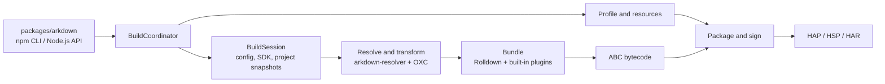

# arkdown

`arkdown` is a Rust-based build tool for OpenHarmony projects. It builds ArkTS/TypeScript projects into
HAP, HSP, and HAR artifacts, using OXC for source transforms and Rolldown for bundling. `packages/arkdown`
is the only supported entry point and provides both the npm CLI and Node.js API.

## Architecture



The Rust crates under `crates/` are internal implementations of the individual build domains.
`packages/arkdown` owns the public entry point and performs coarse build orchestration through
`BuildCoordinator`.

## Benchmark

Measured on July 20, 2026. arkdown was invoked through its only supported entry point, the
`packages/arkdown` Node.js API, with a release-mode native binding. hvigor was invoked through `hvigorw`
with daemon mode disabled. Both tools ran their default Debug HAP build against the same source tree. Project
`build` directories and tool-specific project caches were removed before every sample; cleanup time is not
included.

### Environment

| Item            | Configuration                                         |
| --------------- | ----------------------------------------------------- |
| Device          | MacBook Pro (Mac14,10)                                |
| CPU             | Apple M2 Pro, 12 cores (8 performance + 4 efficiency) |
| Memory          | 16 GB                                                 |
| OS              | macOS 15.6.1, arm64                                   |
| Node.js         | 22.21.1                                               |
| OpenHarmony SDK | 6.1.0.31, API 23                                      |
| arkdown         | 0.0.1-beta.0                                          |
| hvigorw         | 6.21.1                                                |

### Anonymous project scale

Dependency directories, `build` outputs, `.hvigor`, and `.git` are excluded from the source scan.

| Language   |     Files | Physical lines |
| ---------- | --------: | -------------: |
| ArkTS      |     1,772 |        182,027 |
| TypeScript |       149 |         14,410 |
| JavaScript |        80 |         31,849 |
| **Total**  | **2,001** |    **228,286** |

### Clean build comparison

| Sample     | arkdown wall time | hvigor wall time | arkdown peak RSS | hvigor peak RSS |
| ---------- | ----------------: | ---------------: | ---------------: | --------------: |
| 1          |           89.60 s |        1465.45 s |         1.24 GiB |        1.86 GiB |
| 2          |           78.84 s |         835.35 s |         1.27 GiB |        2.52 GiB |
| 3          |           86.15 s |         895.28 s |         1.17 GiB |        2.66 GiB |
| **Median** |       **86.15 s** |     **895.28 s** |     **1.24 GiB** |    **2.52 GiB** |

At the median, hvigor took 10.39 times as long. arkdown reduced wall time by 90.38% and peak RSS by 50.91%
for this project and environment.

Results are representative of this device and project scale; other SDK, hardware, and project
configurations may differ.

## Usage

### Prerequisites

- Node.js 18 or later
- An OpenHarmony or HarmonyOS SDK
- `OHOS_SDK_HOME`, `OHOS_BASE_SDK_HOME`, or `DEVECO_SDK_HOME` pointing to the SDK root

### Install

```sh
npm install @ohos-rs/arkdown
```

### CLI

Build a HAP from an OpenHarmony project:

```sh
npx arkdown build --project ./my-app --target hap --mode debug
```

`--target` accepts `hap`, `hsp`, or `har`; `--mode` accepts `debug` or `release`. Use `--module`, `--product`,
or `--build-target-name` to select a more specific build configuration. Run `npx arkdown build --help` for
the complete option list.

### Node.js API

```js
const { build } = require("@ohos-rs/arkdown");

const result = await build({
  project: "./my-app",
  target: "hap",
  mode: "debug",
});

console.log(result.artifacts);
```

### Build from source

```sh
cd packages/arkdown
pnpm install
pnpm build
pnpm test
```

The package is distributed as `UNLICENSED`.
