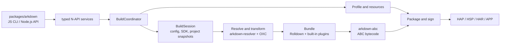

# arkdown

`arkdown` is a Rust-based build tool for OpenHarmony projects. It builds ArkTS/TypeScript projects into
HAP, HSP, HAR, APP, and test outputs, using OXC for source transforms and Rolldown for bundling. `packages/arkdown`
is the only supported entry point and provides both the npm CLI and Node.js API.

## Architecture



The Rust crates under `crates/` are internal implementations of the individual build domains;
`arkdown-abc` owns typed bytecode plans, SDK handoff manifests, and `es2abc` execution, while
`arkdown-native` owns CMake/Ninja planning, native-library processing, strip/binxo, and debug-symbol
artifacts. These are direct implementations of source-observed build behavior, not Hvigor
compatibility layers. Internal Hvigor facades, wrappers, aliases, and parallel legacy paths are
forbidden; only the public TS/JS plugin ABI may retain compatibility code at the JS/N-API boundary.
`arkdown-build` owns typed build requests, module selection, build-application layout,
pre-build validation, intermediate artifact handoffs, code-resource copying, the build coordinator,
watch execution, and package/sign orchestration. `arkdown-pack` owns archive construction and
pre-package validation. `packages/arkdown` owns only the public JS/N-API entry point, value
conversion, asynchronous handoff, diagnostics serialization, and live TS/JS plugin handles.
The npm JavaScript CLI is the only command-line entry: Rust crates must not add binaries, argv
parsers, command-line lifecycle APIs, or Rust `cmd`/`BuildCommand` facades. N-API accepts typed
service requests only.

## Parity testing against a real hvigor

The fixture matrix under `tests/fixtures/` is compared artifact-by-artifact against
a real DevEco-bundled `hvigorw`. Point the harness at that executable directly:

```sh
ARKDOWN_PARITY_HVIGORW=/path/to/command-line-tools/bin/hvigorw \
ARKDOWN_PARITY_STRICT=1 \
cargo test -p arkdown-napi --test hvigor_parity -- --test-threads=1
```

Strict mode has no allowlist or compatibility exception: every normalized
artifact report must be equal. The current status, exact remaining gaps, and
release gates are recorded in
[`meta/tasks/TASK-OXC-ROLLDOWN-HVIGOR-REPLACEMENT.md`](meta/tasks/TASK-OXC-ROLLDOWN-HVIGOR-REPLACEMENT.md).

## Usage

### Performance

Measured on 2026-10-12 with an Apple M2 Pro (12 CPU cores, 16 GiB RAM), macOS 15.6.1,
Node.js 24.14.1, Rust 1.99.0, and HarmonyOS 26.0.0.105 / API 26. Builds use a release-mode
native binding and produce a debug HAP with native debug symbols retained.

| Implementation | After public clean | Unchanged-source rebuild | Peak tree RSS, cold / hot | Peak tree physical footprint, cold / hot |
| --- | ---: | ---: | ---: | ---: |
| Hvigor 6.26.4 | 557.13 s | 6.51 s | 3.84 / 0.64 GiB | 9.82 / 0.48 GiB |
| Arkdown, full checker with cached stages | 181.12 s | 36.05 s | 1.93 / 0.52 GiB | 5.19 / 0.37 GiB |
| Arkdown, full checker before caching | 187.47 s | 137.16 s | 1.77 / 2.03 GiB | 5.33 / 4.79 GiB |
| Arkdown `--skip-checker`, before caching | 103.76 s | 58.90 s | 1.74 / 1.87 GiB | 4.41 / 2.18 GiB |

Each row is one cold/hot pair, not a statistical average. The two rows before caching are
historical references; current measurements use the same current project inputs and run
without other Cargo/Hvigor builds. Cold builds follow the public `clean` command; hot builds
repeat unchanged inputs in a new process. Dependencies, SDK files, and the OS page cache
remain available. Hvigor runs without its daemon, with parallel and incremental builds enabled.
Process-tree memory is sampled every 100 ms; Node uses `--max-old-space-size=8192`.
RSS and macOS physical footprint are separate measurements.

In the current pair, Arkdown uses 67.49% less cold-build time and 47.12% less peak cold-build
physical footprint than Hvigor. Its unchanged-source rebuild is still 5.54 times slower.

Successful checking, packaging, and signing are reused on unchanged inputs. Compile cache
hits verify the generated SDK input files as well as bytecode and source maps; removed or
modified outputs trigger rebuilding. Content hashing runs in parallel with bounded read
buffers. The latest hot stages take 3.338 s for profiles, 1.115 s for compile-cache validation,
0 s for ABC, and 6.379 s for packaging/signing including content validation. Approximately
25.22 s falls outside these recorded stages, including startup, project/SDK snapshots, and
teardown. Startup remains the largest hot-build cost.

SDK callback AST caches now end with the native compiler session, and the CLI exposes GC for
compiler-state release. Normal and strict checker pools are each capped at four workers.
In an instrumented full build with 5,553 SDK AST construction calls, releasing the session
reduced used V8 heap from 1.24 GiB to 28.8 MiB; it stayed near 29.3 MiB through packaging,
compared with 1.19 GiB retained in the earlier implementation.

This removes retained JavaScript ASTs but only modestly changes the complete build's peak:
the earlier cached-stage sample used 5.28 GiB, versus 5.19 GiB in the current sample. A separate
instrumented run peaked during ABC compilation at 5.29 GiB: 3.51 GiB in the build host,
1.77 GiB in `es2abc`, and 0.01 GiB in the CLI parent. Native allocations and SDK subprocesses
remain substantial. A controlled allocator lazy-commit experiment did not improve the peak
and is not enabled. Instrumented samples explain memory ownership; they do not replace the
timing measurements above. Used V8 heap, RSS, and process footprint are different metrics.

### Prerequisites

- Node.js 18 or later
- An OpenHarmony or HarmonyOS SDK
- `OHOS_SDK_HOME`, `OHOS_BASE_SDK_HOME`, or `DEVECO_SDK_HOME` pointing to the SDK root

### Install

```sh
npm install @ohos-rs/arkdown
```

The package does not install or emulate `@ohos/hvigor`. Hvigor is used only as
the source-observed behavioral reference. Verified build behavior is implemented
directly by its Rust owner; internal Hvigor facades, wrappers, aliases, re-exports,
and parallel legacy paths are forbidden. The sole compatibility boundary is the
public TS/JS compile-plugin ABI at the JavaScript/N-API edge.

### CLI

Build a HAP from an OpenHarmony project:

```sh
npx arkdown build --project ./my-app --target hap --mode debug
```

`--target` accepts `hap`, `hsp`, `har`, `app`, or `test`; `--mode` accepts `debug` or `release`. Use `--module`, `--product`,
or `--build-target-name` to select a more specific build configuration. Run `npx arkdown build --help` for
the complete option list. Pass `--enable-zig` to compile native C/C++ sources with `zig cc` and `zig c++`;
the Zig executable must be available on `PATH`. ArkUI-X builds opt in with `--crossplatform`; add
`--ignore-crossplatform-check` only when `11706007` should be reported as a warning instead of an error.
Use `--skip-checker` for an explicit package-first build that omits ArkTS linter and TypeScript
diagnostics. Arkdown still queries the type facts required by OXC transforms, so generated behavior
for `@ObjectLink`, imported builders, annotations, and enums remains unchanged. The standalone
`check` command always performs full validation.

The selected product's `arkTSVersion` chooses ArkTS 1.1 or 1.2; products that
omit it retain the 1.1 schema default. `--arkts-version` is an explicit build
override. ArkTS 1.2 requires an SDK containing the complete `ets/static`
toolchain. Arkdown supports pure static, pure dynamic, and mixed static/dynamic
1.2 modules; mixed HAP/HSP output carries both `modules_static.abc` and
`modules.abc`. The current QEMU packaged SDK does not publish `ets/static`, and
static bytecode obfuscation additionally requires its `ark_guard` executable.
See the replacement plan for the source-backed execution model and validation
gates.

### BuildProfile overrides

Project-wide compile-time constants can be declared in `arkdown.config.toml`:

```toml
[build-profile]
FEATURE_FLAG = true
API_HOST = "https://example.com"
RETRY_COUNT = 3
```

These values override same-named fields from the effective
`buildOption.arkOptions.buildProfileFields` configuration after product,
module, target, and build-script options are merged. Values must be strings,
numbers, or booleans. The legacy `arkdown.config.json` file is used only when
`arkdown.config.toml` is absent.

### Node.js API

```js
const { build } = require("@ohos-rs/arkdown");

const result = await build({
  project: "./my-app",
  target: "hap",
  mode: "debug",
});

console.log(result.artifacts);
```

### TS/JS plugins

The JavaScript API and CLI plugin options accept JavaScript, MJS, CJS, TS,
MTS, and CTS plugin modules. TypeScript plugin modules are compiled by OXC and
Rolldown; JavaScript remains only the live function/context compatibility
boundary while Rust owns plugin ordering, watch events, cache state, and build
lifecycle scheduling.

For ArkTS 1.1 Stage/ESMODULE builds, graph hooks (`buildStart`, `resolveId`,
`load`, `transform`, `moduleParsed`, `buildEnd`), Hvigor lifecycle hooks, cache
hooks, and `watchChange` are active. `watchChange` receives `{ event: 'create'
| 'update' | 'delete' }` before the next `beforeBuild`. Rollup output hooks such
as `renderChunk`, `generateBundle`, and `writeBundle` are accepted for plugin
source compatibility but remain dormant because the upstream ESMODULE path
sets `generateModuleGraphOnly` and `disableGenerateBundle`; Arkdown must not
manufacture JavaScript chunks merely to invoke them.

The only executable entrypoint is `js/arkdown-cli.js`. Rust exposes typed N-API
build/check/clean services and must not add a binary, argv parser, CLI install
mode, process monitor, runtime-report lifecycle, or other CLI-shaped export.
Rust may keep internal structured tracing; JavaScript owns CLI formatting,
stdio policy, process lifecycle, and exit codes.

### Build from source

```sh
cd packages/arkdown
pnpm install
pnpm build
pnpm test
```

The ArkTS checker is tsrs, fetched by Cargo from `ohos-rs/tsrs` with a full
Git `rev` in the workspace dependencies and `Cargo.lock`. Cargo links
`tsrs_api`, `tsrs_core` and `tsrs_vfs` directly into the N-API binding with the
pinned Rust toolchain. Typed snapshots, diagnostics and type facts stay in
process; SDK CommonJS callbacks use the existing JavaScript host. Compiler
programs use `noEmit`. The previous Go checker and executable transport are removed.
Release builds use Cargo `--locked`. Platform package assembly includes the
compiler license and notices; the dependency revision stays in Cargo manifests. The N-API
binding embeds the standard libraries; no separate compiler executable is shipped.

The package is distributed as `UNLICENSED`.
