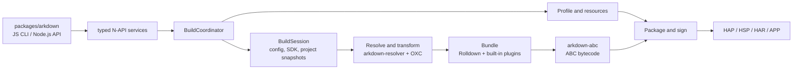

# arkdown

`arkdown` is a Rust-based build tool for OpenHarmony projects. It builds ArkTS/TypeScript projects into
HAP, HSP, HAR, APP, and test outputs, using OXC for source transforms and Rolldown for bundling. `packages/arkdown`
is the only supported entry point and provides both the npm CLI and Node.js API.

## Architecture



The Rust crates under `crates/` are internal implementations of the individual build domains;
`arkdown-abc` owns typed bytecode plans, SDK handoff manifests, and `es2abc` execution, while
`arkdown-native` owns CMake/Ninja planning, native-library processing, strip/binxo, and debug-symbol
artifacts. These are direct implementations of source-observed build behavior, not Hvigor
compatibility layers. Internal Hvigor facades, wrappers, aliases, and parallel legacy paths are
forbidden; only the public TS/JS plugin ABI may retain compatibility code at the JS/N-API boundary.
`arkdown-build` owns typed build requests, module selection, build-application layout,
pre-build validation, intermediate artifact handoffs, code-resource copying, the build coordinator,
watch execution, and package/sign orchestration. `arkdown-pack` owns archive construction and
pre-package validation. `packages/arkdown` owns only the public JS/N-API entry point, value
conversion, asynchronous handoff, diagnostics serialization, and live TS/JS plugin handles.
The npm JavaScript CLI is the only command-line entry: Rust crates must not add binaries, argv
parsers, command-line lifecycle APIs, or Rust `cmd`/`BuildCommand` facades. N-API accepts typed
service requests only.

## Parity testing against a real hvigor

The fixture matrix under `tests/fixtures/` is compared artifact-by-artifact against
a real DevEco-bundled `hvigorw`. Point the harness at that executable directly:

```sh
ARKDOWN_PARITY_HVIGORW=/path/to/command-line-tools/bin/hvigorw \
ARKDOWN_PARITY_STRICT=1 \
cargo test -p arkdown-napi --test hvigor_parity -- --test-threads=1
```

Strict mode has no allowlist or compatibility exception: every normalized
artifact report must be equal. The current status, exact remaining gaps, and
release gates are recorded in
[`meta/tasks/TASK-OXC-ROLLDOWN-HVIGOR-REPLACEMENT.md`](meta/tasks/TASK-OXC-ROLLDOWN-HVIGOR-REPLACEMENT.md).

## Usage

### Performance

Measured on 2026-10-22 with an Apple M2 Pro (12 CPU cores, 16 GiB RAM), macOS 15.6.1,
Node.js 22.23.2, Rust 1.99.0, and DevEco Studio 26.0.0.821 / HarmonyOS API 26. Builds use a
release-mode native binding and produce a debug HAP with native debug symbols retained.

| Implementation | After public clean | Unchanged-source rebuild | Peak tree RSS, cold / hot | Peak tree physical footprint, cold / hot |
| --- | ---: | ---: | ---: | ---: |
| Hvigor 6.26.4 | 629.69 s | 5.96 s | 2.90 / 0.54 GiB | 9.68 / 0.49 GiB |
| Arkdown, full checker with cached stages | 75.36 s | 17.28 s | 1.71 / 0.42 GiB | 2.39 / 0.34 GiB |
| Arkdown `--skip-checker` | 62.94 s | 15.84 s | 1.68 / 0.43 GiB | 2.37 / 0.34 GiB |

The input is a production HarmonyOS application with 11,627 TypeScript files and 23 ETS
files. Arkdown cold/hot values are medians of two cold/hot pairs measured in alternating
order (full cold 77.87/72.85 s, `--skip-checker` cold 64.62/61.25 s; hot 16.21/18.34 s
and 16.35/15.33 s). Hvigor was measured as one cold/hot pair. Each cold run follows the
implementation's public `clean`; hot runs repeat unchanged inputs in a new process.
Dependencies, SDK files, and the OS page cache remain available. Hvigor runs without its
daemon, with parallel and incremental builds enabled. Process-tree memory is sampled every
100 ms (RSS) and 1 s (physical footprint); Node uses `--max-old-space-size=8192`. RSS and
macOS physical footprint are separate measurements. Cold wall time is I/O-dominated and
varies by tens of seconds between runs, so the alternating pair is the controlled
comparison. `--skip-checker` is faster because it omits diagnostics while retaining
transform type facts: median Bundling is 25.85 s versus 36.35 s for the full checker.

In the current pair, Arkdown uses 88.0% less cold-build time (8.4x) and 75.3% less peak
cold-build physical footprint than Hvigor, with 41.1% lower cold-build RSS. Its
unchanged-source rebuild is 2.90 times slower, but uses 21.9% less RSS and 30.2% less
physical footprint.

Successful checking, packaging, and signing are reused on unchanged inputs. Compile cache
hits verify the generated SDK input files as well as bytecode and source maps; removed or
modified outputs trigger rebuilding. Content hashing runs in parallel with bounded read
buffers. The latest Arkdown hot stages take 6.92 s for preparing the project, 3.28 s for
profiles/resources, 0.46 s for bundling, 0 s for ABC, and 7.39 s for packaging/signing
including content validation.

### Prerequisites

- Node.js 18 or later
- An OpenHarmony or HarmonyOS SDK
- `OHOS_SDK_HOME`, `OHOS_BASE_SDK_HOME`, or `DEVECO_SDK_HOME` pointing to the SDK root

### Install

```sh
npm install @ohos-rs/arkdown
```

The package does not install or emulate `@ohos/hvigor`. Hvigor is used only as
the source-observed behavioral reference. Verified build behavior is implemented
directly by its Rust owner; internal Hvigor facades, wrappers, aliases, re-exports,
and parallel legacy paths are forbidden. The sole compatibility boundary is the
public TS/JS compile-plugin ABI at the JavaScript/N-API edge.

### CLI

Build a HAP from an OpenHarmony project:

```sh
npx arkdown build --project ./my-app --target hap --mode debug
```

Builds print stage progress, stage durations, artifact paths, and total elapsed time by default.
Interactive terminals show an animated progress bar with the number of completed stages and the
current stage's elapsed time. The bar advances when a stage finishes; it measures completed stages,
not elapsed-time percentage. CI, redirected output, `TERM=dumb`, and `--clearScreen false` retain
the persistent stage logs.
The final `Build outputs` summary lists all deliverables published by this invocation: unsigned
and signed packages, HSP interface HAR/TGZ files, source maps, pack metadata, and collected symbols
when enabled. Paths are deduplicated and sorted; files left over from other builds are excluded.
The summary heading, output paths, and completion message are highlighted in bold on color terminals.
Like Vite/Rolldown, `--logLevel info` is the default; use `--logLevel debug` for detailed
diagnostics, `warn` or `error` to reduce output, or `silent` (also `--silent`) to suppress it.
`--log-level` and `-l` are aliases. Failed builds still exit with code 1 in silent mode.
Progress updates in place only on a terminal outside CI; redirected output uses plain lines.
Pass `--clearScreen false` to keep progress lines on a terminal, too.
Terminal output uses cyan for progress and artifact paths, green for completed stages and
success summaries, yellow for warnings, red for errors, and gray for debug logs and timings.
CI, redirected streams, and `TERM=dumb` use plain text by default. A non-empty `NO_COLOR`
disables color; `FORCE_COLOR=0` also disables it, while `FORCE_COLOR=1` enables it even in CI
or redirected output. `NO_COLOR` takes precedence. Color detection is independent for stdout
and stderr, and `--clearScreen false` does not disable color.

`--target` accepts `hap`, `hsp`, `har`, `app`, or `test`; `--mode` accepts `debug` or `release`. Use `--module`, `--product`,
or `--build-target-name` to select a more specific build configuration. Run `npx arkdown build --help` for
the complete option list. Pass `--enable-zig` to compile native C/C++ sources with `zig cc` and `zig c++`;
the Zig executable must be available on `PATH`. ArkUI-X builds opt in with `--crossplatform`; add
`--ignore-crossplatform-check` only when `11706007` should be reported as a warning instead of an error.
Use `--skip-checker` for an explicit package-first build that omits ArkTS linter and TypeScript
diagnostics. Arkdown still queries the type facts required by OXC transforms, so generated behavior
for `@ObjectLink`, imported builders, annotations, and enums remains unchanged. The standalone
`check` command always performs full validation.

The selected product's `arkTSVersion` chooses ArkTS 1.1 or 1.2; products that
omit it retain the 1.1 schema default. `--arkts-version` is an explicit build
override. ArkTS 1.2 requires an SDK containing the complete `ets/static`
toolchain. Arkdown supports pure static, pure dynamic, and mixed static/dynamic
1.2 modules; mixed HAP/HSP output carries both `modules_static.abc` and
`modules.abc`. The current QEMU packaged SDK does not publish `ets/static`, and
static bytecode obfuscation additionally requires its `ark_guard` executable.
See the replacement plan for the source-backed execution model and validation
gates.

### BuildProfile overrides

Project-wide compile-time constants can be declared in `arkdown.config.toml`:

```toml
[build-profile]
FEATURE_FLAG = true
API_HOST = "https://example.com"
RETRY_COUNT = 3
```

These values override same-named fields from the effective
`buildOption.arkOptions.buildProfileFields` configuration after product,
module, target, and build-script options are merged. Values must be strings,
numbers, or booleans. The legacy `arkdown.config.json` file is used only when
`arkdown.config.toml` is absent.

### Node.js API

```js
const { build } = require("@ohos-rs/arkdown");

const result = await build({
  project: "./my-app",
  target: "hap",
  mode: "debug",
});

console.log(result.artifacts);
```

The API returns the same complete output list in `result.artifacts`. It accepts the same `logLevel`
values and an optional synchronous `onLog(log)` callback that replaces default console output.
Each log has `level`, `message`, `target`, and structured
`fields`; stage events use `fields.source === "rust_stage"` with `phase` (`start`/`end`),
`step`, `total`, `label`, and an `elapsed_ms` duration on completion. Filters and callbacks are
scoped to each build, including plugin logs. Logs are delivered before the build promise settles.
Color is added only when rendering to the console; `onLog` receives the original structured data.
`ARKDOWN_LOG` (or `RUST_LOG`) can further narrow native diagnostics by tracing target; it does
not override `logLevel`. Build logs are no longer persisted implicitly under `.hvigor`.

### TS/JS plugins

The JavaScript API and CLI plugin options accept JavaScript, MJS, CJS, TS,
MTS, and CTS plugin modules. TypeScript plugin modules are compiled by OXC and
Rolldown; JavaScript remains only the live function/context compatibility
boundary while Rust owns plugin ordering, watch events, cache state, and build
lifecycle scheduling.

For ArkTS 1.1 Stage/ESMODULE builds, graph hooks (`buildStart`, `resolveId`,
`load`, `transform`, `moduleParsed`, `buildEnd`), Hvigor lifecycle hooks, cache
hooks, and `watchChange` are active. `watchChange` receives `{ event: 'create'
| 'update' | 'delete' }` before the next `beforeBuild`. Rollup output hooks such
as `renderChunk`, `generateBundle`, and `writeBundle` are accepted for plugin
source compatibility but remain dormant because the upstream ESMODULE path
sets `generateModuleGraphOnly` and `disableGenerateBundle`; Arkdown must not
manufacture JavaScript chunks merely to invoke them.

The only executable entrypoint is `js/arkdown-cli.js`. Rust exposes typed N-API
build/check/clean services and must not add a binary, argv parser, CLI install
mode, process monitor, runtime-report lifecycle, or other CLI-shaped export.
Rust may keep internal structured tracing; JavaScript owns CLI formatting,
stdio policy, process lifecycle, and exit codes.

### Build from source

```sh
cd packages/arkdown
pnpm install
pnpm build
pnpm test
```

Run `pnpm lint` (oxlint) and `pnpm format:check` (oxfmt) from
`packages/arkdown`; `pnpm lint:fix` and `pnpm format` apply fixes. From the
repository root, run `cargo fmt --all --check`,
`cargo clippy --locked --workspace --all-targets -- -D warnings`, and
`cargo test --locked --workspace --lib --tests`.

CI installs OpenHarmony SDK 6.0 and a local mock component for the vendor
checker callback ABI, then runs Clippy, Rust tests, and native Node
integration tests on Linux, macOS, and Windows. The SDK compiler, resource
processor, and packaging tools execute normally. To run the Node integration
suite locally, build the binding, configure `OHOS_SDK_HOME`, enable
`ARKDOWN_NATIVE_CHECKER_E2E`, `ARKDOWN_NATIVE_PLUGIN_E2E`,
`ARKDOWN_NATIVE_CACHE_E2E`, and `ARKDOWN_NATIVE_WATCH_E2E` with value `1`, then
run `pnpm test:e2e`.

For a public SDK without vendor checker plugins, install the test callback
component with `node packages/arkdown/scripts/prepare-test-sdk.cjs` from the
repository root, pointing `OHOS_SDK_HOME` at an SDK dedicated to testing.

All CI and npm publication jobs use GitHub-hosted runners. Publication waits
for lint, the Linux/macOS/Windows Rust and native integration checks, and the
platform package checks. Strict Hvigor parity remains a local test using the
DevEco-bundled `hvigorw` executable, as described above.

The ArkTS checker is tsrs, fetched by Cargo from `ohos-rs/tsrs` with a full
Git `rev` in the workspace dependencies and `Cargo.lock`. Cargo links
`tsrs_api`, `tsrs_core` and `tsrs_vfs` directly into the N-API binding with the
pinned Rust toolchain. Typed snapshots, diagnostics and type facts stay in
process; SDK CommonJS callbacks use the existing JavaScript host. Compiler
programs use `noEmit`. The previous Go checker and executable transport are removed.
Release builds use Cargo `--locked`. Platform package assembly includes the
compiler license and notices; the dependency revision stays in Cargo manifests. The N-API
binding embeds the standard libraries; no separate compiler executable is shipped.

## License

Original arkdown code is dual-licensed under the [MIT License](LICENSE-MIT) or
the [Apache License, Version 2.0](LICENSE-APACHE), at your option
(`MIT OR Apache-2.0`). Third-party material retains its original license.

[Third-party notices](THIRD_PARTY_NOTICES.md) identify the compiler, bundler,
signing dependencies, and OpenHarmony source references. Their license texts
and upstream notices are included in `licenses/` and distributed with the
main npm package and its native platform packages.
