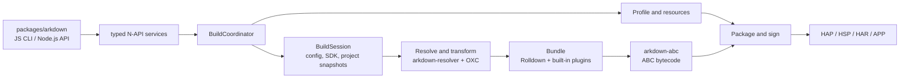

# arkdown

`arkdown` is a Rust-based build tool for OpenHarmony projects. It builds ArkTS/TypeScript projects into
HAP, HSP, HAR, APP, and test outputs, using OXC for source transforms and Rolldown for bundling. `packages/arkdown`
is the only supported entry point and provides both the npm CLI and Node.js API.

## Architecture



The Rust crates under `crates/` are internal implementations of the individual build domains;
`arkdown-abc` owns typed bytecode plans, SDK handoff manifests, and `es2abc` execution, while
`arkdown-native` owns CMake/Ninja planning, native-library processing, strip/binxo, and debug-symbol
artifacts. These are direct implementations of source-observed build behavior, not Hvigor
compatibility layers. Internal Hvigor facades, wrappers, aliases, and parallel legacy paths are
forbidden; only the public TS/JS plugin ABI may retain compatibility code at the JS/N-API boundary.
`arkdown-build` owns typed build requests, module selection, build-application layout,
pre-build validation, intermediate artifact handoffs, code-resource copying, the build coordinator,
watch execution, and package/sign orchestration. `arkdown-pack` owns archive construction and
pre-package validation. `packages/arkdown` owns only the public JS/N-API entry point, value
conversion, asynchronous handoff, diagnostics serialization, and live TS/JS plugin handles.
The npm JavaScript CLI is the only command-line entry: Rust crates must not add binaries, argv
parsers, command-line lifecycle APIs, or Rust `cmd`/`BuildCommand` facades. N-API accepts typed
service requests only.

## Parity testing against a real hvigor

The fixture matrix under `tests/fixtures/` is compared artifact-by-artifact against
a real DevEco-bundled `hvigorw`. Point the harness at that executable directly:

```sh
ARKDOWN_PARITY_HVIGORW=/path/to/command-line-tools/bin/hvigorw \
ARKDOWN_PARITY_STRICT=1 \
cargo test -p arkdown-napi --test hvigor_parity -- --test-threads=1
```

Strict mode has no allowlist or compatibility exception: every normalized
artifact report must be equal. The current status, exact remaining gaps, and
release gates are recorded in
[`meta/tasks/TASK-OXC-ROLLDOWN-HVIGOR-REPLACEMENT.md`](meta/tasks/TASK-OXC-ROLLDOWN-HVIGOR-REPLACEMENT.md).

## Usage

### Prerequisites

- Node.js 18 or later
- An OpenHarmony or HarmonyOS SDK
- `OHOS_SDK_HOME`, `OHOS_BASE_SDK_HOME`, or `DEVECO_SDK_HOME` pointing to the SDK root

### Install

```sh
npm install @ohos-rs/arkdown
```

The package does not install or emulate `@ohos/hvigor`. Hvigor is used only as
the source-observed behavioral reference. Verified build behavior is implemented
directly by its Rust owner; internal Hvigor facades, wrappers, aliases, re-exports,
and parallel legacy paths are forbidden. The sole compatibility boundary is the
public TS/JS compile-plugin ABI at the JavaScript/N-API edge.

### CLI

Build a HAP from an OpenHarmony project:

```sh
npx arkdown build --project ./my-app --target hap --mode debug
```

`--target` accepts `hap`, `hsp`, `har`, `app`, or `test`; `--mode` accepts `debug` or `release`. Use `--module`, `--product`,
or `--build-target-name` to select a more specific build configuration. Run `npx arkdown build --help` for
the complete option list. Pass `--enable-zig` to compile native C/C++ sources with `zig cc` and `zig c++`;
the Zig executable must be available on `PATH`. ArkUI-X builds opt in with `--crossplatform`; add
`--ignore-crossplatform-check` only when `11706007` should be reported as a warning instead of an error.

ArkTS 1.1 is the default when `--arkts-version` is omitted. ArkTS 1.2 is entered
only with `--arkts-version 1.2`; it currently requires an SDK containing the
complete `ets/static` toolchain and is not yet a replacement-complete path. See
the replacement plan for the source-backed 1.2 execution model and remaining
gates.

### BuildProfile overrides

Project-wide compile-time constants can be declared in `arkdown.config.toml`:

```toml
[build-profile]
FEATURE_FLAG = true
API_HOST = "https://example.com"
RETRY_COUNT = 3
```

These values override same-named fields from the effective
`buildOption.arkOptions.buildProfileFields` configuration after product,
module, target, and build-script options are merged. Values must be strings,
numbers, or booleans. The legacy `arkdown.config.json` file is used only when
`arkdown.config.toml` is absent.

### Node.js API

```js
const { build } = require("@ohos-rs/arkdown");

const result = await build({
  project: "./my-app",
  target: "hap",
  mode: "debug",
});

console.log(result.artifacts);
```

### TS/JS plugins

The JavaScript API and CLI plugin options accept JavaScript, MJS, CJS, TS,
MTS, and CTS plugin modules. TypeScript plugin modules are compiled by OXC and
Rolldown; JavaScript remains only the live function/context compatibility
boundary while Rust owns plugin ordering, watch events, cache state, and build
lifecycle scheduling.

For ArkTS 1.1 Stage/ESMODULE builds, graph hooks (`buildStart`, `resolveId`,
`load`, `transform`, `moduleParsed`, `buildEnd`), Hvigor lifecycle hooks, cache
hooks, and `watchChange` are active. `watchChange` receives `{ event: 'create'
| 'update' | 'delete' }` before the next `beforeBuild`. Rollup output hooks such
as `renderChunk`, `generateBundle`, and `writeBundle` are accepted for plugin
source compatibility but remain dormant because the upstream ESMODULE path
sets `generateModuleGraphOnly` and `disableGenerateBundle`; Arkdown must not
manufacture JavaScript chunks merely to invoke them.

The only executable entrypoint is `js/arkdown-cli.js`. Rust exposes typed N-API
build/check/clean services and must not add a binary, argv parser, CLI install
mode, process monitor, runtime-report lifecycle, or other CLI-shaped export.
Rust may keep internal structured tracing; JavaScript owns CLI formatting,
stdio policy, process lifecycle, and exit codes.

### Build from source

```sh
cd packages/arkdown
pnpm install
pnpm build
pnpm test
```

The package is distributed as `UNLICENSED`.
