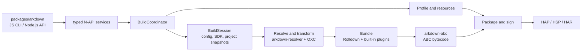

# arkdown

`arkdown` is a Rust-based build tool for OpenHarmony projects. It builds ArkTS/TypeScript projects into
HAP, HSP, and HAR artifacts, using OXC for source transforms and Rolldown for bundling. `packages/arkdown`
is the only supported entry point and provides both the npm CLI and Node.js API.

## Architecture



The Rust crates under `crates/` are internal implementations of the individual build domains;
`arkdown-abc` owns typed bytecode plans, SDK handoff manifests, and `es2abc` execution, while
`arkdown-native` owns CMake/Ninja planning, native-library processing, strip/binxo, and debug-symbol
artifacts. These are direct implementations of source-observed build behavior, not Hvigor
compatibility layers. Internal Hvigor facades, wrappers, aliases, and parallel legacy paths are
forbidden; only the public TS/JS plugin ABI may retain compatibility code at the JS/N-API boundary.
`arkdown-build` owns typed build requests, module selection, build-application layout,
pre-build validation, intermediate artifact handoffs, code-resource copying, the build coordinator,
watch execution, and package/sign orchestration. `arkdown-pack` owns archive construction and
pre-package validation. `packages/arkdown` owns only the public JS/N-API entry point, value
conversion, asynchronous handoff, diagnostics serialization, and live TS/JS plugin handles.
The npm JavaScript CLI is the only command-line entry: Rust crates must not add binaries, argv
parsers, command-line lifecycle APIs, or Rust `cmd`/`BuildCommand` facades. N-API accepts typed
service requests only.

## Benchmark

Measured on July 24, 2026. arkdown was invoked through its only supported entry point, the
`packages/arkdown` Node.js API, with a release-mode native binding. hvigor was invoked through `hvigorw`
with daemon mode disabled. Both tools ran their default Debug HAP build against the same source tree. Project
`build` directories and tool-specific project caches were removed before every sample; cleanup time is not
included. Installed dependencies and SDK toolchains were retained.

Memory was sampled every 100 ms with
[`measure-process-tree.mjs`](packages/arkdown/scripts/measure-process-tree.mjs). On macOS the sampler uses
`proc_pid_rusage(RUSAGE_INFO_V4)` and recursively follows the launched process and all of its descendants.
Peak process-tree values are the sum of all live descendants in the same sample, not the largest individual
process reported by `/usr/bin/time`.

### Environment

| Item            | Configuration                                         |
| --------------- | ----------------------------------------------------- |
| Device          | MacBook Pro (Mac14,10)                                |
| CPU             | Apple M2 Pro, 12 cores (8 performance + 4 efficiency) |
| Memory          | 16 GB                                                 |
| OS              | macOS 15.6.1, arm64                                   |
| Node.js         | 22.21.1                                               |
| OpenHarmony SDK | 6.1.0.31, API 23                                      |
| arkdown         | 0.0.1-beta.11                                         |
| hvigorw         | 6.24.3 (DevEco-bundled, run via `hvigor/tools/arkdown-hvigorw`) |

### Anonymous project scale

Dependency directories, `build` outputs, `.hvigor`, and `.git` are excluded from the source scan.

| Language   |     Files | Physical lines |
| ---------- | --------: | -------------: |
| ArkTS      |     1,772 |        182,027 |
| TypeScript |       149 |         14,410 |
| JavaScript |        80 |         31,849 |
| **Total**  | **2,001** |    **228,286** |

### Clean build comparison

| Sample     | arkdown wall time | hvigor wall time | arkdown process-tree RSS | hvigor process-tree RSS |
| ---------- | ----------------: | ---------------: | -----------------------: | ----------------------: |
| 1          |           49.25 s |         417.95 s |                 2.11 GiB |                5.30 GiB |
| 2          |           47.99 s |         407.68 s |                 2.18 GiB |                4.87 GiB |
| 3          |           52.47 s |         419.55 s |                 2.18 GiB |                5.63 GiB |
| **Median** |       **49.25 s** |     **417.95 s** |             **2.18 GiB** |            **5.30 GiB** |

On macOS, physical footprint is the metric closest to the Memory column in Activity Monitor. It includes
memory that RSS alone does not represent:

| Sample     | arkdown process-tree footprint | hvigor process-tree footprint | hvigor main Node footprint |
| ---------- | -----------------------------: | ----------------------------: | -------------------------: |
| 1          |                       2.81 GiB |                      9.74 GiB |                   7.73 GiB |
| 2          |                       2.91 GiB |                      9.55 GiB |                   7.69 GiB |
| 3          |                       2.84 GiB |                      9.33 GiB |                   7.73 GiB |
| **Median** |                   **2.84 GiB** |                  **9.55 GiB** |               **7.73 GiB** |

At the median, hvigor took 8.49 times as long. arkdown reduced wall time by 88.22%, peak process-tree RSS
by 58.89%, and peak process-tree physical footprint by 70.29% for this project and environment.

Results are representative of this device and project scale; other SDK, hardware, and project
configurations may differ.

## Parity testing against a real hvigor

The fixture matrix under `tests/fixtures/` is compared artifact-by-artifact against
the DevEco-bundled hvigor. The bundled `hvigorw` cannot install `@ohos/hvigor`
from any public npm registry (the IDE provisions the packages itself), so
`hvigor/tools/arkdown-hvigorw` provisions the per-project workspace from the
DevEco installation and runs the engine directly:

```sh
ARKDOWN_PARITY_HVIGORW="$PWD/hvigor/tools/arkdown-hvigorw" \
ARKDOWN_PARITY_RUN=1 \
cargo test -p arkdown-napi --test hvigor_parity
```

Requires DevEco Studio at `/Applications/DevEco-Studio.app` (override with
`DEVECO_APP`). Verified against hvigor 6.24.3: all 25 parity tests pass with
zero diffs across HAP/HSP/source-HAR/ByteCode-HAR fixtures in debug and
release modes, including cold/unchanged/changed incremental builds.

## Usage

### Prerequisites

- Node.js 18 or later
- An OpenHarmony or HarmonyOS SDK
- `OHOS_SDK_HOME`, `OHOS_BASE_SDK_HOME`, or `DEVECO_SDK_HOME` pointing to the SDK root

### Install

```sh
npm install @ohos-rs/arkdown
```

The package does not install or emulate `@ohos/hvigor`. Hvigor is used only as
the source-observed behavioral reference. Verified build behavior is implemented
directly by its Rust owner; internal Hvigor facades, wrappers, aliases, re-exports,
and parallel legacy paths are forbidden. The sole compatibility boundary is the
public TS/JS compile-plugin ABI at the JavaScript/N-API edge.

### CLI

Build a HAP from an OpenHarmony project:

```sh
npx arkdown build --project ./my-app --target hap --mode debug
```

`--target` accepts `hap`, `hsp`, or `har`; `--mode` accepts `debug` or `release`. Use `--module`, `--product`,
or `--build-target-name` to select a more specific build configuration. Run `npx arkdown build --help` for
the complete option list. Pass `--enable-zig` to compile native C/C++ sources with `zig cc` and `zig c++`;
the Zig executable must be available on `PATH`. ArkUI-X builds opt in with `--crossplatform`; add
`--ignore-crossplatform-check` only when `11706007` should be reported as a warning instead of an error.

### BuildProfile overrides

Project-wide compile-time constants can be declared in `arkdown.config.toml`:

```toml
[build-profile]
FEATURE_FLAG = true
API_HOST = "https://example.com"
RETRY_COUNT = 3
```

These values override same-named fields from the effective
`buildOption.arkOptions.buildProfileFields` configuration after product,
module, target, and build-script options are merged. Values must be strings,
numbers, or booleans. The legacy `arkdown.config.json` file is used only when
`arkdown.config.toml` is absent.

### Node.js API

```js
const { build } = require("@ohos-rs/arkdown");

const result = await build({
  project: "./my-app",
  target: "hap",
  mode: "debug",
});

console.log(result.artifacts);
```

### TS/JS plugins

The JavaScript API and CLI plugin options accept JavaScript, MJS, CJS, TS,
MTS, and CTS plugin modules. TypeScript plugin modules are compiled by OXC and
Rolldown; JavaScript remains only the live function/context compatibility
boundary while Rust owns plugin ordering, watch events, cache state, and build
lifecycle scheduling.

For ArkTS 1.1 Stage/ESMODULE builds, graph hooks (`buildStart`, `resolveId`,
`load`, `transform`, `moduleParsed`, `buildEnd`), Hvigor lifecycle hooks, cache
hooks, and `watchChange` are active. `watchChange` receives `{ event: 'create'
| 'update' | 'delete' }` before the next `beforeBuild`. Rollup output hooks such
as `renderChunk`, `generateBundle`, and `writeBundle` are accepted for plugin
source compatibility but remain dormant because the upstream ESMODULE path
sets `generateModuleGraphOnly` and `disableGenerateBundle`; Arkdown must not
manufacture JavaScript chunks merely to invoke them.

The only executable entrypoint is `js/arkdown-cli.js`. Rust exposes typed N-API
build/check/clean services and must not add a binary, argv parser, CLI install
mode, process monitor, runtime-report lifecycle, or other CLI-shaped export.
Rust may keep internal structured tracing; JavaScript owns CLI formatting,
stdio policy, process lifecycle, and exit codes.

### Build from source

```sh
cd packages/arkdown
pnpm install
pnpm build
pnpm test
```

The package is distributed as `UNLICENSED`.
