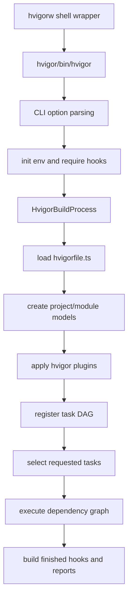
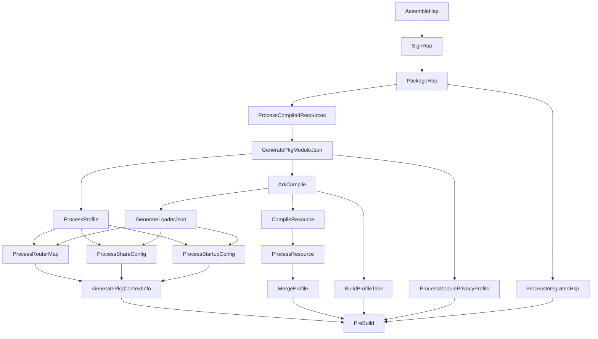
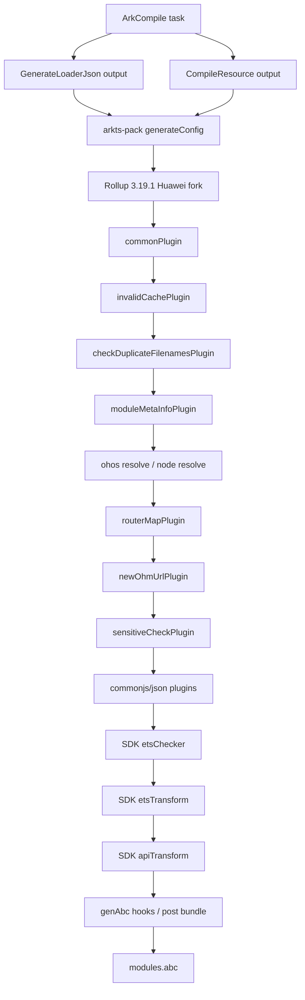

# hvigor 6.1.1.280 Build Flow

Source baseline:

```text
/Users/ranger/.meat/ide/DevEco-Studio-6.1.1.280.app/Contents/tools/hvigor
```

Package versions observed in the local installation:

- `@ohos/hvigor@6.24.2`
- `@ohos/hvigor-ohos-plugin@6.24.2`
- `@ohos/hvigor-arkts-base@6.24.2`
- `@ohos/hvigor-arkts-compose@6.24.2`
- `rollup@3.19.1-htrunk1.AllScenario.devecostudio.r35`

## Entry Flow



## HAP Build DAG



## Main Stages

| Stage | hvigor tasks / files | Rust rewrite owner |
| --- | --- | --- |
| CLI boot | `hvigor/bin/*`, `hvigor/src/cli/**`, `hvigor/src/base/boot/**` | `arkdown-cli` |
| Session/model discovery | `hvigor-ohos-plugin/src/plugin/**`, `model/**`, `options/**` | `arkdown-session`, `arkdown-config`, `arkdown-ohpm` |
| Task graph planning | `hvigor/src/base/internal/task/**`, `hvigor-ohos-plugin/src/tasks/manager/**` | `arkdown-cli` build plan and runner |
| Profile processing | `merge-profile`, `process-profile`, router/share/startup/privacy tasks | `arkdown-profile` |
| Resource compile | `process-resource`, `compile-resource`, restool builders | `arkdown-resource` |
| Loader generation | `generate-loader-json`, dependency metadata helpers | `arkdown-profile` plan output consumed by `arkdown` |
| ArkTS bundle | `ark-compile`, `hvigor-arkts-compose/dist/src/arkts-pack.*` | `arkdown`, plugin crates, `arkdown-ets-transform` |
| Rollup cache/importees | `hvigor-arkts-base/dist/src/build*`, `cache/rollup/**` | `arkdown-cache`, `arkdown` |
| ABC compile | SDK compile plugin and es2abc handoff | `arkdown-ts2abc`, `arkdown-abc` |
| Packaging | `package-hap`, `package-hsp`, `package-har`, pack info tasks | `arkdown-pack` |
| Signing | `sign-hap`, `sign-hsp`, signing command builders | `arkdown-sign` |
| Watch/hot reload | watch, hot/cold reload, importer collection | `arkdown-watcher`, `arkdown-cli` |

## ArkTS/Rollup Plugin Chain



## Rust Planning Rule

The TS reconstruction is for reading behavior and validating ordering. The Rust
rewrite must not mirror hvigor's dynamic task classes directly. It must convert
the observed DAG into typed plans:

```text
BuildSession -> BuildPlan -> ModuleCompileContext -> domain plans -> artifacts
```

Domain crates consume typed plans and owned snapshots. They must not rediscover
project files, SDK metadata, dependency roots, or profile/resource inventories
inside hot build stages.

