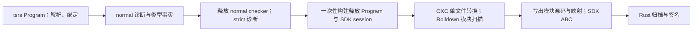

# tsrs AST 与 Hvigor 流程的内存可行性评估

2026-10-21。范围：ArkTS 1.1、ESMODULE；区分一次性构建和 watch。
本文件记录首轮源码核验与现有边界测试，当时没有修改生产实现、依赖 pin 或启用迁移。
后续第三方向的局部实现与 A/B 实测见 [OXC 重复解析合并验证](PERF-OXC-SOURCE-MAP-PARSE-REUSE.md)。

结论：有继续降内存的空间，但当前证据不支持为了内存把 AST 转换整体迁到 tsrs。
tsrs 承担解析、绑定、类型推断和只读语义查询已经可行且正在使用；把 ArkUI lowering、
annotation runtime metadata、TS/JS 生成也移入 tsrs，需要新增完整能力，并重新验证
生命周期和产物。复用 parser AST 不等于降低整个构建的峰值。

**核验版本与证据强度**

| 仓库 | 本轮读取版本 |
| --- | --- |
| arkdown | `cabacc667da43b26b14cb5c3a821ba76940ec19e` |
| tsrs | `4d7e69df3847b5e0e5708b22a3f713082e5e6d02`，与 Cargo pin 一致 |
| Rolldown fork | `63112ceaa35eb24750a09d0ce3ae6f2f8074ed42`，与 Cargo pin 一致 |
| developtools_ace_ets2bundle | `45b3c707d1d173a6d81a514512ef2c831eaf3ec5` |

读取了 ets2bundle 根目录和 compiler README，以及下述实际 owner。
旧文档中的 `third_party/tsrs` gitlink 描述不是当前依赖方式；本轮以根 Cargo.toml 的 git revision 为准。
下文 GB/MiB 数字来自 [R11 历史测量](PERF-CHECKER-SDK-PLUGIN-MEMORY.md)，不是当前 HEAD 的新基准。
历史原始探针目录当前不可用，本轮没有复跑该大工程，也没有 tsrs 转换迁移后的 A/B 结果。

**Hvigor 实际如何使用 AST**

1. `compiler/src/fast_build/ets_ui/rollup-plugin-ets-checker.ts::etsChecker.buildStart`
   调用 `serviceChecker`，建立并保留 `globalProgram`。
2. `rollup-plugin-ets-typescript.ts::transform` 的 ESM 分支从
   `globalProgram.program.getSourceFile(id)` 取得 AST，复用 checker。
   根据 `getShouldEmitJs` 选择 `Program.emit` 或 `ts.transformNodes`，运行
   `processUISyntax`、`expandAllImportPaths`、`processKitImport` 等转换。
   它临时关闭 `noEmit`，最后恢复；保留 TS 的分支通过 `meta.tsAst` 传递转换后的树。
   checker 图未包含的运行时模块有单独的补建路径，不能把类型图直接当作运行时模块图。
3. `ark_compiler/module/module_source_file.ts::processModuleSourceFiles`
   按 module ID 排序，处理模块引用并写出编译输入，之后清空 sourceFiles。
   `singleFileEmit` 分支由 `rollup-plugin-gen-abc.ts::moduleParsed` 调用
   `processSingleModuleSourceFile`，取走单文件记录并写出。
4. `generate_module_abc.ts::generateModuleAbc` 完成这些交接后调用对应 ModuleMode；
   `module/module_mode.ts::generateMergedAbcOfEs2Abc` 所在流程构造 SDK es2abc 任务。
   最终 HAP/HSP/HAR/APP 归档与签名并不是 Rolldown/OXC 的职责。

这个流程证明“保留 TS AST 做转换”有上游行为依据，但没有证明这种内存生命周期优于当前实现。
产物和 hook 语义必须对齐，内部 Program 的持有时间无需照搬。

**当前实现与内存生命周期**

- [project_checker.rs](../../crates/arkdown-build/src/project_checker.rs) 的一次性路径显式
  `drop(program/session/prepared)`；`check_program` 在 strict 前提取拥有独立所有权的 facts
  并释放 normal checker。因此主要 checker 和 bundler 阶段不是两份全工程 AST 同时常驻。
- 同一文件的 `semantic_source_inputs` 会并行调用
  [ArktsSourceSemanticCollector](../../crates/arkdown-ets-transform/src/transform/source_semantic_inventory.rs)。
  这是一次真实的额外 OXC parse，但每次 allocator 随调用释放，只保留查询 spans 和名称。
  这部分与 tsrs Program 共存，不能误称为所有 OXC 操作都在 checker 释放之后。
- [bundler/mod.rs](../../crates/arkdown/src/bundler/mod.rs) 的一次性路径调用
  `scan_module_sources`。Rolldown `stages/scan_stage.rs` 使用 `retain_link_output=false`；
  `module_loader/module_loader.rs` 丢弃 `(ast, symbols, stmt_infos)`。
  它仍会构建扫描 AST，保留模块信息与源码，但没有把整个链接 AST 图留到构建结束。
- watch 使用 `ProjectSemanticRuntime` 保留 tsrs snapshot，同时在缓存 bundle 中调用
  `scan_modules(Full/Partial)`。该入口走保留链接输出的路径，其状态进入增量缓存。
  因而 watch 有不同的共存关系，不能套用一次性构建的峰值结论。
- [rolldown_plan.rs](../../crates/arkdown-ets-transform/src/rolldown_plan.rs) 中还有
  lowering → finalize → lazy import → 按需 JS emit/format 的文本交接与重复解析。
  保留给 ABC 的源码和给 Rolldown 扫描的源码可能语义上不同，不能直接删除其中一份。

**迁移可行性判定**

| 方案 | 技术判断 | 内存判断 |
| --- | --- | --- |
| tsrs 检查/推断，OXC 转换，Rolldown 模块图 | 当前已实现 | 允许阶段提前释放，继续作为基线 |
| tsrs 在已有 AST 上收集语义查询候选，返回紧凑 facts | 可设计小范围原型；必须覆盖现有查询与诊断名称合同 | 能减少一次 OXC inventory parse；峰值收益未测，不应承诺大幅下降 |
| 把 tsrs AST 直接交给 Rolldown | 当前接口不支持直接共享 | 两套 AST 布局、allocator、符号 ID 不同；转换建树仍需分配 |
| tsrs 完成 ArkUI/annotation 转换及 emit，再给 Rolldown | 当前不具备完整能力，需要迁移 owner 和建立输出合同 | 可能少解析，也可能延长 Program 生命周期；收益尚未成立 |
| 融合同一阶段中的 OXC passes/打印 | 有源码可追踪的局部优化方向 | 主要减少临时树、源码和 map 分配；需测量是否影响全局峰值 |
| watch 只缓存模块扫描所需数据 | 当前完整缓存路径支持这一调查方向 | 可能减少长驻 AST/符号表；必须验证增量复用，收益未测 |

tsrs `crates/tsrs_compiler/src/emitter.rs::emit_js_file` 对 ArkUI/annotation 语法明确
发出 **TS100069** 并跳过 JS emit；`crates/tsrs_cli/tests/arkts.rs` 有对应拒绝测试。
`docs/EMIT.md` 和 `docs/ARKTS.md` 同样明确把这些 lowering 留给 Arkdown。
因此“通用 TypeScript emit 已实现”不能作为“Hvigor ArkUI 转换已实现”的证据。

tsrs `embedded::ProgramSnapshot` 公开的是不可变 snapshot 与 owned 查询结果；底层
`program()` 私有，未提供可直接替换现有 OXC transformer 的可变 AST 接口。
Rolldown 的 `HookTransformAstArgs.ast` 则要求 `EcmaAst`，内部是 OXC
`ProgramCell { source, allocator, Program }`。跨树映射还需处理源码范围、comments、
语义 ID 和 synthetic nodes，既不是零拷贝，也不是换一个 hook 参数。
OXC 官方也说明 AST 采用 arena 分配；仅凭“统一 AST”无法推出驻留内存收益。
参考：[OXC 架构](https://github.com/oxc-project/oxc/blob/main/ARCHITECTURE.md)。

SDK 插件还有第三种 AST：
[plugin-adapter.js](../../packages/arkdown/js/plugin-adapter.js) 的 class callback
通过 SDK TypeScript `createSourceFile` 创建真实 JS 节点，供 `getText/getStart` 等 ABI 使用。
把 Rust lowering 换成 tsrs 并不会自动消除这份 V8 AST；减少其驻留需要独立验证插件合同。

**已知内存证据及优先级**

R11 收尾的一次性构建峰值约 2.36 GB；阶段时间线的 checker 峰值约 2.25 GB，
包含 tsrs arena 约 991 MiB、mimalloc 约 738 MiB、V8 约 408 MiB。
这些是分配器/虚拟内存分类，不能全部算作 AST，也不能把不同采样时刻直接相加。
Rolldown 阶段约 1.78 GB；ABC/pack/sign 的主进程阶段值约 0.6 GB。
这些数值不代表任意项目、当前 HEAD 或完整 SDK 子进程树都有相同峰值。

对这种串行一次性流程，全局峰值取各阶段峰值的最大值。
如果 normal checker 完全不变，只优化后面的 OXC/Rolldown，历史 workload 的全局峰值可能不变。

优先验证以下独立候选，不启动整体 AST 迁移：

1. 一次性 checker 的 syscap 跨批结果缓存与增量专用状态。
   [R11 P2-5](PERF-CHECKER-SDK-PLUGIN-MEMORY.md) 记录缓存约 54 MiB，跨批命中约 0.11%；
   cached VFS memo 和 sourceFS 跟踪约 40 MiB。合计 90–100 MiB 是旧采样下的潜力估计，
   不是本轮已达成的收益。当前 tsrs `ohsdkplugin.rs` 仍保留完成结果。
   需由 tsrs 的缓存/快照 owner 提供类型化生命周期策略，arkdown checker 只选择一次性策略；
   watch 和 strict 仍需 SDK 的配置必须保留原合同。
2. watch 的 Rolldown 缓存。在 Rolldown bundle/scan/cache owner 中验证不保留链接输出的增量路径，
   arkdown 只消费模块记录与 facts。现有轻量入口消费 bundle 且仅公开 Full scan，不能直接替换
   当前借用 bundle 的 Partial scan；失效闭包、cache hooks、失败后恢复都必须验证。
3. OXC 单文件重复 parse/print。由 `arkdown-ets-transform` 的 pass/输出 owner 合并局部生命周期；
   只在已验证 hook 顺序和双源码合同后研究与 Rolldown AST hook 的交接。
   禁止为省解析而在整个 session 中保留所有 OXC AST。
4. tsrs 查询候选收集。只迁移为类型查询服务的只读遍历；UI/runtime 转换仍由 transform crate 拥有。
   这与“全部 AST 操作交给 tsrs”是不同规模的改动。

**进入迁移前的验证门槛**

每个候选必须单独 A/B，先恢复真实大工程在当前 HEAD 的基线，再交替测量至少三组冷构建；
分别记录 normal、facts、strict、scan、ABC、归档/签名和 watch 重建后的存活内存。
必须区分进程树 footprint、RSS、Rust live allocations 和 V8 committed，不能只看 Node heapUsed。
不得以 `--skip-checker` 的结果替代默认构建收益。

正确性覆盖：诊断消息/顺序/位置，模块源码、sourceMaps、ABC 和 HAP 条目；
包含 ArkUI V1/V2、annotation、跨文件 Builder/ObjectLink、kit/lazy imports、JS 混合导入、
shouldEmitJs、SDK class plugins、bytecode HAR。watch 还需叶子变更/删除/恢复和缓存失效验证。
线程数 1 与多线程必须保持确定性；报告耗时、重解析次数及内存收益是否超过测量噪声。

当前仓库规则固定 tsrs 为 `noEmit`，把输出职责迁给 tsrs 属于架构合同变更。
本轮按用户“先验证、后决定迁移”的范围保留该边界；结论没有把规则本身当作技术不可行的理由。
若未来选择完整迁移，必须先补齐源码定义的 lowering、printer/map 和插件交接合同，
通过矩阵后删除被替换的 OXC 生产路径与仅维护旧边界的测试，不能长期保留双实现 fallback。

本轮执行的验证：

- `node --test packages/arkdown/__test__/runtime-architecture.test.cjs`：6/6 通过。
- `node --test packages/arkdown/__test__/plugin-adapter.test.cjs`：26/26 通过。
- 校验 tsrs、Rolldown 本地 revision 与 workspace pin 一致；上游 checkout 工作树干净。

这些测试验证当前边界和 SDK AST 缓存/释放行为，不证明未实现迁移的产物等价或内存收益。
