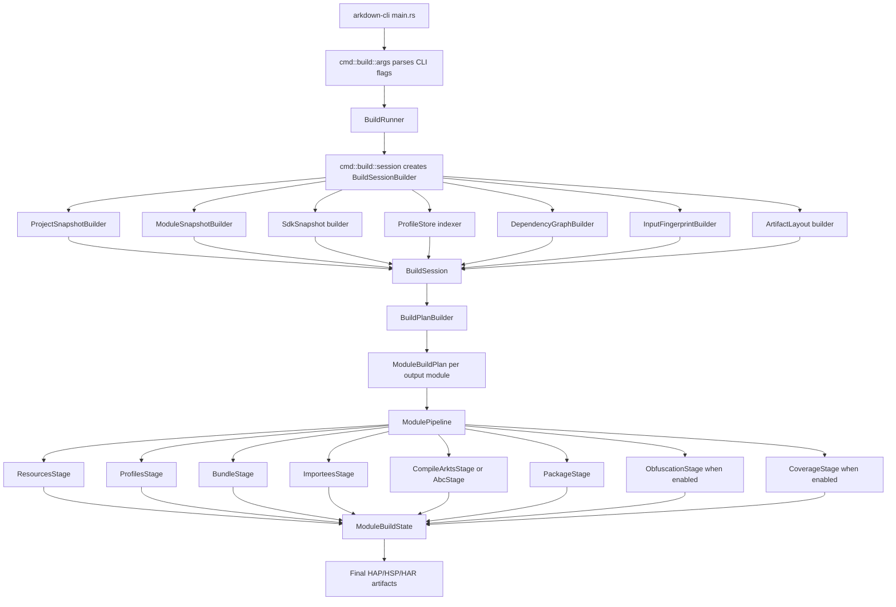
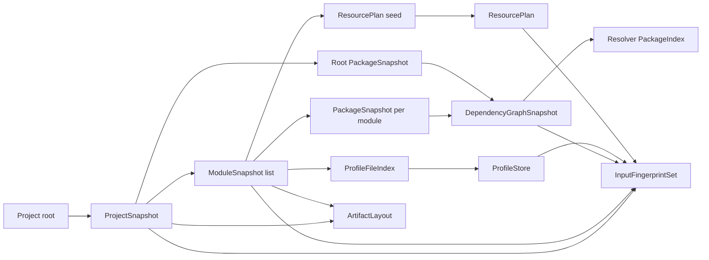
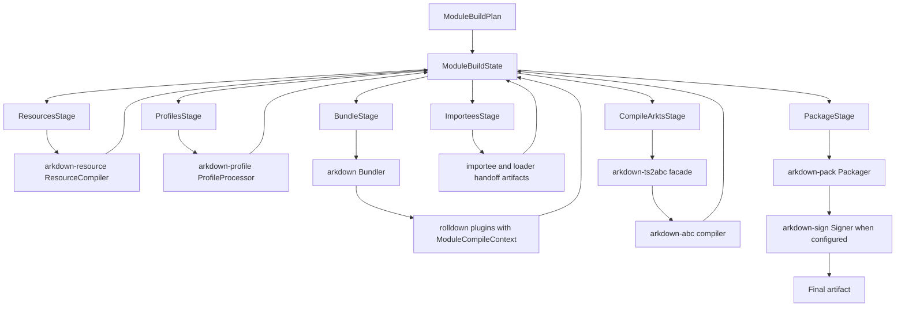
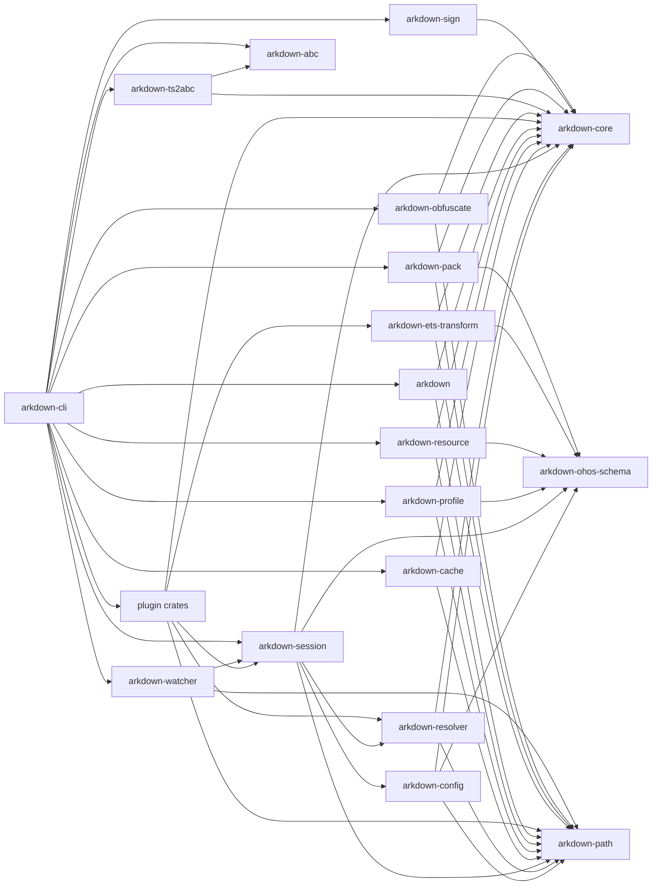

# SPEC-048: Build Session Architecture Refactor

**Crate**: multi-crate, with new `arkdown-session`
**Priority**: P1
**Blocked by**: SPEC-005, SPEC-010, SPEC-019
**Blocks**: SPEC-039, SPEC-040 hardening, future watch and incremental work
**Status**: Proposed

---

## Summary

Refactor arkdown around a build-session model aligned with Rolldown's ownership
style: construct all stable project, module, dependency, SDK, profile, resource,
and path metadata once at startup, then pass a typed context through the full
compile pipeline and plugin stack.

The goal is not a minimal patch. The goal is a maintainable architecture:

1. Startup builds a reusable `BuildSession` and per-module `ModuleCompileContext`.
2. Later stages consume snapshots instead of re-reading `module.json5`,
   `oh-package.json5`, profile JSON, SDK metadata, and dependency roots.
3. Plugins receive the same context model as the bundler, instead of each plugin
   creating private filesystem caches and ad hoc scanners.
4. Free functions are moved behind owning objects where they need state,
   filesystem access, caching, or lifecycle.
5. File and directory organization is reshaped so modules reflect ownership,
   not implementation accidents.
6. Path handling is made cross-platform. Internal code uses `Path` and `PathBuf`;
   slash strings are produced only by artifact serializers and OHM URL builders.

---

## Breaking Rewrite Directive

This SPEC intentionally allows breaking changes to internal Rust APIs. The
compatibility boundary is:

- Preserve CLI flags and generated artifacts unless this SPEC explicitly says
  otherwise.
- Preserve fixture behavior and hvigor parity expectations.
- Do not preserve old internal helper APIs, old crate exports, or old plugin
  constructors when they block ownership cleanup.

The refactor must not introduce thin compatibility wrappers that keep the old
architecture alive. When a caller is migrated to the new session/context API,
the old helper must be deleted in the same change unless another production
caller still depends on it. If another caller still depends on it, that helper
must be marked as a migration blocker in this SPEC or in the task PR.

No "minimum viable" implementation is acceptable for the core session model.
The first session implementation must own real startup reads, dependency graph
construction, profile indexing, SDK metadata, path normalization, and input
fingerprints. Narrow adapters are acceptable only inside tests.

---

## Workspace Audit Snapshot

Current scan summary from `crates/*/src`:

| Crate | Files | Function count | IO hits | Path smell hits | Refactor pressure |
| --- | ---: | ---: | ---: | ---: | --- |
| `arkdown-core` | 10 | 128 | 2 | 11 | stale plugin/context types and string path helpers |
| `arkdown-config` | 7 | 87 | 24 | 48 | raw config parsing mixed with discovery and SDK probing |
| `arkdown-resolver` | 6 | 58 | 22 | 10 | package index built from filesystem in resolver lifecycle |
| `arkdown-utils` | 1 | 4 | 0 | 1 | too small to host path policy; needs focused modules |
| `arkdown-loader` | 5 | 23 | 1 | 3 | legacy plugin/loader stack separate from rolldown |
| `arkdown` | 4 | 33 | 9 | 19 | bundler derives paths and entries from strings |
| `arkdown-profile` | 18 | 453 | 419 | 122 | largest repeated-read and helper concentration |
| `arkdown-plugin-duplicate-check` | 1 | 9 | 0 | 1 | simple plugin; context constructor still needed |
| `arkdown-plugin-ets-transform` | 38 | 600 | 32 | 28 | SDK/component metadata and transform cache not session-owned |
| `arkdown-cache` | 1 | 36 | 14 | 2 | cache keys not tied to full input fingerprints |
| `arkdown-plugin-json5` | 3 | 31 | 3 | 5 | plugin reads files during hooks; needs source abstraction |
| `arkdown-plugin-module-meta` | 4 | 18 | 4 | 11 | upward package walking and string package ownership |
| `arkdown-plugin-ohos-resolve` | 4 | 42 | 7 | 18 | resolver plugin owns path parsing and importee side effects |
| `arkdown-plugin-har-dedup` | 1 | 16 | 4 | 5 | detects HAR ownership with `contains("oh_modules")` |
| `arkdown-plugin-router-map` | 1 | 8 | 6 | 1 | standalone cache invalidation duplicates profile fingerprints |
| `arkdown-plugin-sensitive-check` | 1 | 12 | 4 | 3 | duplicate case-check implementation |
| `arkdown-abc` | 32 | 1254 | 29 | 15 | mostly cohesive compiler, but cache/path entry naming leaks |
| `arkdown-ts2abc` | 6 | 33 | 6 | 20 | CLI-style argument parsing owns path/record derivation |
| `arkdown-resource` | 11 | 52 | 34 | 3 | scanner/writers must consume `ResourcePlan` |
| `arkdown-pack` | 5 | 48 | 37 | 2 | packager reads module JSON and integrated HSP inputs late |
| `arkdown-sign` | 7 | 108 | 11 | 4 | signing remains isolated and must use artifact layout |
| `arkdown-cli` | 20 | 175 | 176 | 75 | orchestration owns too many stage policies and helpers |
| `arkdown-obfuscate` | 5 | 44 | 11 | 5 | file traversal and rule loading move into a stage plan |
| `arkdown-watcher` | 1 | 12 | 0 | 7 | watches raw directories instead of session input inventory |

This means the refactor must touch every crate at the ownership boundary, even
if some crates only need constructor/API changes.

---

## Crate Boundary Audit

### Current dependency graph

Current normal workspace dependencies from `cargo metadata`:

| Crate | Workspace dependencies |
| --- | --- |
| `arkdown` | `arkdown-config`, `arkdown-core`, `arkdown-loader`, `arkdown-plugin-duplicate-check`, `arkdown-plugin-ets-transform`, `arkdown-plugin-json5`, `arkdown-plugin-module-meta`, `arkdown-plugin-ohos-resolve`, `arkdown-profile`, `arkdown-resolver` |
| `arkdown-abc` | `arkdown-core` |
| `arkdown-cache` | `arkdown-core`, `arkdown-utils` |
| `arkdown-cli` | `arkdown`, `arkdown-abc`, `arkdown-cache`, `arkdown-config`, `arkdown-core`, `arkdown-obfuscate`, `arkdown-pack`, `arkdown-plugin-duplicate-check`, `arkdown-plugin-ets-transform`, `arkdown-plugin-har-dedup`, `arkdown-plugin-json5`, `arkdown-plugin-module-meta`, `arkdown-plugin-ohos-resolve`, `arkdown-plugin-router-map`, `arkdown-profile`, `arkdown-resolver`, `arkdown-resource`, `arkdown-sign`, `arkdown-ts2abc`, `arkdown-utils`, `arkdown-watcher` |
| `arkdown-config` | `arkdown-core` |
| `arkdown-core` | none |
| `arkdown-loader` | `arkdown-core`, `arkdown-resolver` |
| `arkdown-obfuscate` | `arkdown-core`, `arkdown-utils` |
| `arkdown-pack` | `arkdown-core`, `arkdown-utils` |
| `arkdown-plugin-duplicate-check` | none |
| `arkdown-plugin-ets-transform` | `arkdown-cache`, `arkdown-core`, `arkdown-utils` |
| `arkdown-plugin-har-dedup` | none |
| `arkdown-plugin-json5` | none |
| `arkdown-plugin-module-meta` | `arkdown-core`, `arkdown-resolver` |
| `arkdown-plugin-ohos-resolve` | `arkdown-core`, `arkdown-resolver` |
| `arkdown-plugin-router-map` | `arkdown-utils` |
| `arkdown-plugin-sensitive-check` | none |
| `arkdown-profile` | `arkdown-config`, `arkdown-core`, `arkdown-utils` |
| `arkdown-resolver` | `arkdown-core`, `arkdown-utils` |
| `arkdown-resource` | none |
| `arkdown-sign` | `arkdown-core` |
| `arkdown-ts2abc` | `arkdown-abc` |
| `arkdown-utils` | none |
| `arkdown-watcher` | `arkdown-core` |

### Cycle result

No actual Cargo-level cycle is present in the current normal dependency graph.
`cargo metadata` succeeds, and Cargo would reject a normal package dependency
cycle.

There are still architectural "near cycles" that will become real cycles if
the session model is added without adjusting crate boundaries:

- If `arkdown-session` depends on `arkdown-profile` for profile schemas while
  `arkdown-profile` depends on `arkdown-session` for `ModuleCompileContext`, a
  direct cycle appears.
- If `arkdown-resource` or `arkdown-pack` depends on `arkdown-session` for plans
  while `arkdown-session` depends on those crates to construct plans, a direct
  cycle appears.
- If `arkdown` keeps depending on concrete plugin crates while plugins need
  bundler/session types, plugin composition becomes a high-level back edge.

The target design must avoid these by keeping schemas, path types, and plan
types below orchestration.

### Mandatory OXC and Rolldown Layering Rules

The refactor must use the same dependency discipline as OXC and Rolldown:

- Foundation crates contain data types, paths, spans, schemas, diagnostics, and
  generic primitives. They must not depend on phase, plugin, session, or CLI
  crates.
- Phase crates perform one domain operation. A phase crate must accept a typed
  plan and return a typed output. It must not discover projects.
- Plugin crates are adapters. A plugin crate must translate rolldown hook input
  into a domain operation. It must not own project discovery, SDK scanning,
  profile reads, package graph construction, cache policy, or artifact layout.
- The bundler crate must depend on rolldown APIs and arkdown foundation types.
  It must not depend on concrete plugin crates.
- Shared JSON schemas and path types must live below all processors. High-level
  crates must not depend on each other just to share schema structs.

### Mandatory Final Crate Set

The final workspace crate set is fixed by this SPEC. Crates in `Add` must be
created. Crates in `Delete` must be removed from `[workspace].members` after
their production callers are migrated.

| Action | Crate | Hard rule |
| --- | --- | --- |
| Keep | `arkdown-core` | Domain-neutral types and errors only. Old plugin API and resolver/path policy are deleted. |
| Add | `arkdown-path` | Owns path-domain newtypes, lexical normalization, path classification, and artifact path serialization. |
| Add | `arkdown-ohos-schema` | Owns raw OHOS JSON/JSON5 schemas for app, module, package, profile, loader, package info, and signing metadata. |
| Keep | `arkdown-config` | Owns config normalization and SDK manifest probing only. Raw schemas move to `arkdown-ohos-schema`. |
| Add | `arkdown-session` | Owns startup snapshots, dependency graph, profile store, SDK snapshot, resource input inventory, artifact layout, and fingerprints. |
| Keep | `arkdown-resolver` | Owns pure OHOS resolution over resolver input indexes. It does not read package files in hot paths. |
| Delete | `arkdown-utils` | Generic helper bucket is removed. Path helpers move to `arkdown-path`; hash/cache helpers move to `arkdown-cache` or `arkdown-session::fingerprint`. |
| Delete | `arkdown-loader` | Legacy `ArkdownPlugin`/`PluginDriver` loader stack is removed. Rolldown is the only production plugin pipeline. |
| Keep | `arkdown` | Owns rolldown bundling and output conversion. It receives plugins as trait objects and never imports concrete plugin crates. |
| Keep | `arkdown-profile` | Owns profile processors and module/loader JSON writers over typed plans. It does not depend on `arkdown-session`. |
| Keep | `arkdown-cache` | Owns cache storage, manifests, and cache keys over supplied fingerprints. It does not decide build inputs. |
| Keep | `arkdown-abc` | Owns Rust ABC compiler, IR, emit, reader, optimizer, and program cache. No new split in this refactor. |
| Keep | `arkdown-ts2abc` | Owns upstream-compatible ts2abc facade and production `Ts2abcPlan` mapping to `arkdown-abc`. |
| Keep | `arkdown-resource` | Owns resource compiler over `ResourceCompilePlan`. It does not depend on `arkdown-session`. |
| Keep | `arkdown-pack` | Owns package archive construction over `PackagePlan`. It does not perform late project reads. |
| Keep | `arkdown-sign` | Owns signing over `SignPlan`. It remains isolated from build session internals. |
| Keep | `arkdown-cli` | Owns command parsing, orchestration, progress, and stage composition. Broad dependencies are allowed only here. |
| Keep | `arkdown-obfuscate` | Owns obfuscation over `ObfuscationPlan`; rule discovery input comes from session/build planning. |
| Keep | `arkdown-watcher` | Owns watch/debounce/invalidation over session input inventory. |
| Add | `arkdown-ets-transform` | Owns OXC-based ArkTS transform core independent of rolldown hooks, cache storage, and CLI. |
| Keep | `arkdown-plugin-ets-transform` | Thin rolldown adapter for `arkdown-ets-transform`. |
| Keep | `arkdown-plugin-ohos-resolve` | Thin rolldown resolver adapter for `arkdown-resolver`. |
| Keep | `arkdown-plugin-module-meta` | Thin rolldown adapter for module metadata records from session/resolver indexes. |
| Keep | `arkdown-plugin-json5` | Thin rolldown adapter for JSON5 module loading/emission. |
| Keep | `arkdown-plugin-duplicate-check` | Thin rolldown output validation plugin. |
| Keep | `arkdown-plugin-har-dedup` | Thin rolldown adapter for HAR dedup metadata from dependency ownership. |
| Delete | `arkdown-plugin-router-map` | Router map invalidation moves to `ProfileStore` fingerprints. No standalone plugin remains. |
| Delete | `arkdown-plugin-sensitive-check` | Case-sensitive path checking moves into `arkdown-resolver::case_check`. No standalone plugin remains. |

### Mandatory Dependency Direction

The target dependency direction is:

```text
foundation:
  arkdown-core
  arkdown-path
  arkdown-ohos-schema

configuration and resolution:
  arkdown-config -> foundation
  arkdown-resolver -> foundation

session:
  arkdown-session -> foundation + arkdown-config + arkdown-resolver

domain crates:
  arkdown-profile -> foundation
  arkdown-resource -> foundation
  arkdown-pack -> foundation
  arkdown-sign -> foundation
  arkdown-cache -> foundation
  arkdown-obfuscate -> foundation + OXC
  arkdown-abc -> foundation + OXC
  arkdown-ts2abc -> arkdown-abc + foundation
  arkdown-ets-transform -> foundation + OXC

plugin adapters:
  arkdown-plugin-* -> rolldown_plugin + required domain crate + arkdown-session

orchestration:
  arkdown -> rolldown + foundation
  arkdown-cli -> all stage/domain crates + arkdown-session
  arkdown-watcher -> arkdown-session + foundation
```

Hard dependency rules:

- Domain crates own narrow plan structs such as `ResourceCompilePlan`,
  `PackagePlan`, `ProfileProcessPlan`, `ObfuscationPlan`, and `Ts2abcPlan`.
- `BuildPlanBuilder` must convert `ModuleCompileContext` into those plan
  structs.
- Domain crates must not depend on `arkdown-session`.
- `arkdown-session` must not depend on profile/resource/pack/sign/cache/plugin
  crates.
- `arkdown` must not depend on concrete plugin crates.
- Plugins are allowed to carry `Arc<ModuleCompileContext>`, but the bundler crate must receive
  plugins through `rolldown_plugin` trait objects and does not depend on
  concrete plugin crates.
- `arkdown-cli` is the only crate allowed to compose all stages.
- Any dependency edge that violates this table must be removed before the
  refactor is considered complete.

---

## Mandatory Rust Code Style Rules

These rules are part of the refactor acceptance criteria. They align arkdown
with OXC's phase-crate style and Rolldown's plugin/bundler ownership model.

### Ownership and modules

- Every non-trivial operation must have an owning type:
  `BuildSessionBuilder`, `DependencyGraphBuilder`, `ProfileStore`,
  `BuildPlanBuilder`, `ModulePipeline`, `ResourceCompiler`, `Packager`,
  `Signer`, `OhosResolver`, or a named transform pass.
- Free functions are allowed only for pure local algorithms that do not read
  files, do not write files, do not cache state, do not inspect global config,
  and do not encode stage lifecycle.
- Modules named `utils`, `helpers`, `common`, or `misc` are forbidden for build
  policy. Use domain names such as `paths`, `fingerprint`, `package_index`,
  `artifact_layout`, `source_set`, `profile_store`, or `record_name`.
- `mod.rs` files must only declare modules and re-export narrow public APIs.
  They must not contain stage policy or filesystem logic.
- Public exports must be minimal. Internal APIs use `pub(crate)` or private
  items. Crate roots do not re-export implementation modules by wildcard.

### State and context

- Long parameter chains are forbidden when the parameters represent build state.
  Use state structs such as `ModuleCompileContext`, `ModuleBuildState`,
  `ResourceCompilePlan`, `ProfileProcessPlan`, `PackagePlan`, or `Ts2abcPlan`.
- Shared build data must be immutable snapshots behind `Arc`.
- Mutable data must stay inside the current builder/stage object. Cross-stage
  mutation is allowed only through `ModuleBuildState`.
- Global singletons are forbidden for build state, SDK state, package indexes,
  profile caches, and path policy.
- Constructors must make ownership obvious. A type that needs session data must
  accept context or a narrow plan, not raw project/module path strings.

### Filesystem and paths

- Filesystem paths must use `Path`, `PathBuf`, `AbsPath`, or `RelPath`.
- Artifact paths must use `ArtifactPath`.
- Module import/export text must use `ModuleSpecifier`.
- Runtime OHM URLs must use `OhmUrl`.
- `.to_string_lossy()` is allowed only for diagnostics or final artifact
  serialization. It is forbidden for identity, cache keys, package matching,
  resolver matching, and dependency graph keys.
- Inline slash conversion with `.replace('\\', "/")` is forbidden outside
  `arkdown-path::serializer`.
- `starts_with('/')`, `contains("oh_modules")`, and path classification by
  substring are forbidden.
- Output paths that do not exist must be lexically normalized. They must not be
  canonicalized.
- Existing input paths are canonicalized only inside `PathResolver` or
  startup builders.

### IO and caching

- Startup discovery IO must live in `arkdown-session`.
- Source content reads during bundling must come from rolldown hook input or a
  session-owned source store.
- Plugin hooks must not read `module.json5`, `oh-package.json5`, SDK metadata,
  profile JSON, or dependency roots.
- Cache keys must be built from `InputFingerprintSet` or explicit content
  hashes. Placeholder hashes are forbidden.
- Directory traversal output must be sorted before it affects artifacts, cache
  keys, diagnostics, or tests.
- Library crates must expose typed errors. `anyhow` is allowed in CLI and tests
  only.

### OXC usage

- JavaScript/TypeScript/ArkTS parsing must use OXC parser APIs.
- AST transforms must use OXC AST visitors, builders, spans, and codegen. Raw
  string rewriting is forbidden when an OXC AST/codegen route exists.
- If raw source patches are required for an upstream-compatible transform, they
  must be represented as span-based patch objects and applied in a deterministic
  order.
- OXC allocator lifetimes must not leak into session snapshots, cache entries,
  or long-lived build state. Persisted transform output must be owned strings,
  source maps, or typed metadata.
- Generated JS/TS must be emitted through OXC codegen or a structured serializer
  such as `module_emit`. Ad hoc string assembly is limited to fixed wrappers
  that cannot be represented by OXC APIs.

### Rolldown usage

- `arkdown` owns rolldown bundler setup and output conversion.
- Concrete plugin construction belongs to `arkdown-cli` or build planning, not
  `arkdown`.
- Plugin crates implement `rolldown_plugin::Plugin` directly. No adapter from
  `arkdown-core::ArkdownPlugin` is allowed.
- A plugin adapter must be thin: hook input plus context goes into a domain
  operation, then hook output is returned.
- Plugin `HookUsage` must list only hooks the plugin actually implements.
- Source maps must use `rolldown_sourcemap` or `string_wizard` compatible
  structures. Source map path fields must go through `ArtifactPathSerializer`.

### Determinism and tests

- Public artifact order must be deterministic. Use `IndexMap` or sorted vectors
  where ordering reaches artifacts, cache keys, or diagnostics.
- Hash maps with nondeterministic iteration must not be serialized directly.
- Tests for path handling must include Unix, Windows-drive, UNC, non-UTF-8
  display boundaries where the platform supports them, and component-based
  `oh_modules` classification.
- Every moved helper must have one owner test at the new owner boundary.
- Every deleted crate must have its old production behavior covered by the
  replacement crate's tests before deletion.

---

## Performance and Memory Refactor Plan

Performance and memory ownership are part of the architecture contract. This
refactor moves parallel work to explicit build executors, removes duplicate
input reads, replaces non-OXC dense-index infrastructure, and makes deterministic
merge order a mandatory part of every parallel stage.

### Current performance audit

| Area | Current evidence | Mandatory refactor |
| --- | --- | --- |
| Dense indexes | The workspace declares `index_vec = "0.1"` and direct users exist in `arkdown-core`, `arkdown`, `arkdown-cli`, and `arkdown-plugin-ohos-resolve`. | Remove `index_vec` from the workspace and replace all uses with `oxc_index`. |
| Parallel runtime | `rayon` is a workspace dependency, but the only discovered production `into_par_iter` path is in `arkdown-loader`, which is deleted by this spec. | Parallelism must move into `arkdown-session` inventory builders and `arkdown-cli` stage executors. Domain crates expose batch APIs; they do not spawn ad hoc parallel work. |
| Startup IO | `module.json5`, `oh-package.json5`, profile JSON, SDK component metadata, resource trees, and package roots are read by multiple crates and plugin hooks. | `BuildSessionBuilder` reads and fingerprints startup inputs once. Later stages consume snapshots, source-store entries, or typed plans. |
| Plugin collectors | `arkdown-plugin-module-meta`, `arkdown-plugin-har-dedup`, and bundler-side collectors use `Arc<Mutex<...>>`-style shared mutation. | Plugin structs must not own mutex-backed hot-path collectors. Bundle outputs are collected into stage-owned buffers and merged by typed IDs after bundling. |
| String identities | Package names, module names, import specifiers, source paths, record names, and artifact paths are repeatedly cloned as `String`. | Stable identities use typed IDs plus `Arc<str>`, `Box<str>`, or `CompactString` according to lifetime. Large structs are moved by ID, not cloned across stages. |
| Directory traversal | Resource, profile, resolver, pack, and CLI code walk directories independently and often sort locally. | Traversal belongs to session inventory or a stage planner. Directory output is normalized once, stored in typed inventories, and merged deterministically. |
| Final writers | Loader JSON, source maps, pack entries, ABC records, and signed artifacts require stable output order. | Collection work is parallel; serialization and format writers run in explicit sorted order. |

### Dependency and data-structure mandates

- The root workspace dependency `index_vec` must be removed.
- The root workspace dependency `oxc_index = "4.1.0"` must be added and versioned
  with the OXC dependency set already used by the workspace.
- All existing `index_vec::Idx` and `index_vec::IndexVec` users must migrate to
  `oxc_index::Idx` and `oxc_index::IndexVec`.
- Dense IDs must live in the owning crate and be exported only when the ID
  crosses a crate boundary:
  - `arkdown-core`: `ModuleId`, `ChunkId`, `BundleOutputId`
  - `arkdown-session`: `ProjectId`, `PackageId`, `DependencyNodeId`,
    `ProfileFileId`, `ResourceFileId`, `SourceFileId`, `SdkFileId`
  - `arkdown-resource`: `ResourceEntryId`, `ResourceOutputId`
  - `arkdown-profile`: `ProfileArtifactId`
  - `arkdown-abc`: `RecordId`, `FunctionId`, `LiteralArrayId`,
    `CompileUnitId`
  - `arkdown-pack`: `PackEntryId`
- Dense collections use `IndexVec<Id, T>`.
- Lookup side tables use `FxHashMap<Key, Id>` and never serialize directly.
- `IndexMap` is reserved for semantic user-facing order or golden artifact
  order. Internal lookup order uses typed IDs plus sorted vectors.
- Long-lived snapshot strings use `Arc<str>` when shared by multiple stages.
- Owned non-shared schema strings use `Box<str>`.
- Hot short identifiers copied inside resolver, bundle output, and transform
  metadata use `CompactString`; add `compact_str` to root
  `[workspace.dependencies]`.
- `String` remains allowed for mutation buffers, serde scratch values,
  diagnostics, and final serialization.
- Source contents in the session source store use `Arc<[u8]>` for raw bytes and
  `Arc<str>` for validated UTF-8 source text.
- Parsed OXC AST data must not be stored in session snapshots. Each parallel
  transform task owns its allocator and emits owned metadata or source output.
- Resource binary contents must not be cached in memory by default. The session
  stores path, stat metadata, and content fingerprint; bytes are streamed by
  resource or pack writers.

### Parallel execution model

Parallelism is centralized in two places:

1. `arkdown-session::ParallelInventoryBuilder`
2. `arkdown-cli::StageExecutor`

Every parallel job returns `(TypedId, Output)` or `(TypedId, Diagnostic,
Output)`. The caller writes results into `IndexVec` by ID and performs a sorted
merge before serialization, diagnostics, cache key construction, or artifact
writing.

### Startup parallelization

`BuildSessionBuilder` must split startup discovery into deterministic parallel
inventories:

- Project and build profile selection remain sequential because CLI arguments
  and build-profile precedence define root policy.
- Module roots are discovered sequentially, assigned `ModuleId`, then parsed in
  parallel.
- `module.json5` files are read, parsed, and fingerprinted in parallel.
- `oh-package.json5` files for project modules, dependency roots, HAR/HSP
  packages, and integrated HSP roots are read, parsed, and fingerprinted in
  parallel.
- Profile JSON inventories are discovered in parallel by profile kind and
  stored by `ProfileFileId`.
- Resource roots are scanned in parallel by module and source-set overlay.
- SDK component metadata and SDK API metadata are read in parallel and stored
  in `SdkSnapshot`.
- Source-file inventories for ArkTS/TS/JS are collected in parallel by source
  root. File contents are read on demand through `SourceStore`, but content
  fingerprints are built during session startup when cache mode requires them.
- Dependency graph node parsing is parallel. Edge normalization and
  topological ordering are deterministic and run by `DependencyGraphBuilder`
  after all node inputs exist.

### Stage parallelization

`BuildRunner` executes modules in dependency waves:

```text
BuildSession
  -> BuildPlan
  -> Dependency wave 0: modules without build-time dependency barriers
  -> Dependency wave 1: modules whose dependencies completed
  -> ...
```

Within a dependency wave, modules run in parallel when their output directories,
cache keys, and package destinations are disjoint. Cross-module shared writes
are forbidden.

Inside one module, `ModulePipeline` executes this stage graph:

```text
ModuleCompileContext
  -> resource inventory normalization
  -> profile source processing
  -> bundle
  -> ETS transform output reuse
  -> ABC compile units
  -> pack entry collection
  -> deterministic package writer
  -> signer
```

Mandatory parallel boundaries:

- Resource scanning and profile source processing run in parallel after
  `ModuleCompileContext` exists.
- Resource copy/compile work is parallel by `ResourceEntryId`; duplicate
  destination detection happens before writes.
- Profile processors parse independent profile files in parallel and merge by
  dependency graph order plus artifact path order.
- Rolldown bundling remains owned by `arkdown::Bundler`; plugin hooks must
  consume context snapshots and must not perform their own package/profile
  discovery.
- ETS source transforms are parallel by `SourceFileId` or rolldown module ID.
  Each task owns its OXC allocator and returns span patches, generated code,
  source map fragments, and transform metadata.
- CompileArkTS and ABC lowering are parallel by `CompileUnitId` where inputs are
  independent. Final ABC emission, record table ordering, string table ordering,
  and binary writing are deterministic.
- Pack entry discovery and hashing are parallel by `PackEntryId`. Zip/package
  writing is sequential in sorted artifact order.
- Signing is sequential. It consumes the final package bytes and writes a single
  signed artifact.

### Non-parallel boundaries

The following operations must remain sequential or must have a sequential final
merge:

- CLI argument parsing and build-profile selection.
- Final dependency graph topological ordering.
- Loader JSON serialization.
- `module.json` and merged profile artifact serialization.
- Source map concatenation and path serialization.
- ABC final binary table layout.
- Zip/HAP/HSP/HAR writer order.
- Signing.
- Cache database commit and manifest update.

### Plugin hot-path rules

- Plugin constructors accept `Arc<ModuleCompileContext>` or a narrower
  context-backed plan.
- Plugin `resolve_id`, `load`, and `transform` hooks must not call
  `std::fs::*`, `fs_err::*`, `WalkDir`, or package/profile loaders.
- Plugin structs must not contain `Arc<Mutex<FxHashMap<...>>>`,
  `Arc<Mutex<Vec<...>>>`, or equivalent shared mutable collectors for hot
  hooks.
- A plugin that needs post-bundle data must write typed hook facts into a
  stage-owned collector keyed by `ModuleId`, `SourceFileId`, or rolldown module
  ID. The collector merges after bundling and before artifact writing.
- Resolver plugins use `PackageIndex`, `SourceSetIndex`, and `PathResolver`
  snapshots. Upward filesystem walking is deleted from production code.
- JSON5 plugin content reads go through rolldown-provided source or
  `SourceStore`; direct file reads in the hook are forbidden.

### Crate-level performance mandates

| Crate | Mandatory performance and memory changes |
| --- | --- |
| `arkdown-core` | Replace `index_vec` with `oxc_index`; keep dense graph/chunk storage in `IndexVec`; expose typed IDs instead of cloning graph nodes. |
| `arkdown-path` | Provide allocation-minimal path normalization and artifact serialization; own all slash conversion; return borrowed path components where possible. |
| `arkdown-ohos-schema` | Store parsed schema strings as `Box<str>` unless shared by session snapshots; no filesystem reads. |
| `arkdown-config` | Normalize config into typed values and stop re-reading manifests after session construction starts. |
| `arkdown-session` | Own parallel startup inventory, `SourceStore`, fingerprint sets, package indexes, profile inventories, resource inventories, and SDK snapshots. |
| `arkdown-resolver` | Use session-built indexes as resolver input; no `read_dir` or package manifest reads in hot resolution. |
| `arkdown` | Own rolldown execution and output conversion; replace mutex collectors with typed bundle output buffers; migrate dense chunk/module data to `oxc_index`. |
| `arkdown-ets-transform` | Own reusable transform passes, per-file OXC allocator usage, transform cache keys, and parallel transform batch APIs. |
| `arkdown-plugin-ohos-resolve` | Use context indexes only; replace string package ownership checks with `PackageId` lookups. |
| `arkdown-plugin-module-meta` | Delete upward package-root search; collect module metadata through typed bundle facts, not mutex maps. |
| `arkdown-plugin-json5` | Parse rolldown or source-store content; no direct file reads in hook bodies. |
| `arkdown-plugin-har-dedup` | Use dependency graph ownership metadata; no string matching over absolute module IDs for package ownership. |
| `arkdown-plugin-duplicate-check` | Normalize IDs through `arkdown-path`; keep comparisons allocation-light and read-free. |
| `arkdown-plugin-sensitive-check` | Delete crate; case checking moves into resolver path validation. |
| `arkdown-plugin-router-map` | Delete crate; router map loading moves into `ProfileStore` and router profile processing. |
| `arkdown-profile` | Parse profile inputs from `ProfileStore`; parallel parse by `ProfileFileId`; deterministic merge by dependency graph and artifact path. |
| `arkdown-resource` | Parallel scan/compile by resource entry; store inventories in session; write outputs by deterministic artifact path order. |
| `arkdown-pack` | Parallel collect/hash entries; keep final archive writer sequential and sorted. |
| `arkdown-sign` | Keep signing sequential; stream package bytes instead of retaining duplicate buffers. |
| `arkdown-cache` | Hash inventories in parallel; commit cache manifests sequentially; use typed fingerprint sets as keys. |
| `arkdown-abc` | Use `oxc_index` for record/function/literal tables; parallelize independent lowering units; keep final binary layout sequential and deterministic. |
| `arkdown-ts2abc` | Represent compile inputs as typed compile units; avoid cloning argument strings into multiple vectors. |
| `arkdown-obfuscate` | Store rename maps with compact identifiers; apply span patches in deterministic order; no raw whole-source clone unless output changes. |
| `arkdown-watcher` | Reuse session inventories; recompute changed fingerprints in parallel; rebuild only affected module waves. |
| `arkdown-cli` | Own `StageExecutor`, dependency-wave scheduling, and per-module `ModuleBuildState`; delete index-coupled parallel vectors. |
| `arkdown-utils` | Delete crate; no performance helper crate replaces it. |
| `arkdown-loader` | Delete crate; its BFS parallel loader is not carried forward. |

### Measurement and regression gates

- `rg "index_vec"` must return no production dependency or source use after the
  migration.
- `rg "Arc<Mutex" crates/arkdown-plugin-* crates/arkdown/src` must return no
  hot-path collector in production code.
- `rg "read_to_string|fs::read|read_dir|WalkDir" crates/arkdown-plugin-*` must
  return no hook-time production reads.
- Build output for the same fixture must be byte-for-byte identical with
  `RAYON_NUM_THREADS=1` and `RAYON_NUM_THREADS=8`.
- Session inventory tests must prove each manifest/profile/package input is
  read once per session build.
- Cache tests must prove fingerprint changes invalidate the owning stage
  without invalidating unrelated module waves.
- Memory tests or targeted assertions must prove resource binary contents are
  not stored in `BuildSession` snapshots.

---

## Current Architectural Problems

### Repeated startup data reads

The same files are read from multiple stages:

- `module.json5` is read in config resolution to classify modules, then read
  again in CLI profile processing.
- `oh-package.json5` is read by module planning, loader generation, dependency
  graph building, resolver indexing, module metadata, bytecode HAR scanning,
  integrated HSP collection, and CompileArkTS metadata.
- Router map, startup config, share config, insight intent, and resource profile
  JSON files are loaded by separate feature-specific functions.

This prevents a reliable incremental model because there is no single inventory
of build inputs.

### Duplicate dependency graph logic

The repository currently has several dependency traversals with similar but not
identical behavior:

- `arkdown-profile::dependency_graph::LocalDependencyGraph`
- `process_share_config` dependency root collection
- `process_startup_config` dependency root collection
- `scan_bytecode_har_deps`
- `OhosResolver::PackageRootIndex`
- CLI integrated HSP scanning
- loader JSON HSP/HAR map collection

These must be backed by one dependency snapshot with typed node metadata.

### Split plugin systems

The active bundler uses `rolldown_plugin::Plugin`, while
`arkdown-core::ArkdownPlugin` and `arkdown-loader::PluginDriver` still exist as
a separate API surface. That split makes context propagation and lifecycle
ownership ambiguous.

### Free functions with hidden ownership

Many free functions are not pure helpers. They read files, scan directories,
derive cache keys, mutate artifacts, or encode target-specific policy. Those
functions must belong to stateful objects such as builders, stores, writers,
or stage structs.

### Path handling is not portable enough

Current code often treats filesystem paths as strings:

- `starts_with('/')` is used to detect absolute paths.
- `contains("oh_modules")` is used to classify package ownership.
- path segments are removed with `trim_start_matches("./")`.
- extension stripping is done with repeated string suffix trimming.
- slash conversion happens inline across multiple crates.
- artifact path strings and real filesystem paths are mixed in the same fields.

This is fragile on Windows paths, drive prefixes, UNC paths, symlinks,
case-insensitive filesystems, and paths containing non-UTF-8 bytes.

---

## Target Architecture

### New crate: `arkdown-session`

Add a new workspace crate:

```text
crates/arkdown-session/
  Cargo.toml
  src/
    lib.rs
    session.rs
    builder.rs
    project.rs
    module.rs
    dependency_graph.rs
    package.rs
    profile_store.rs
    resource_plan.rs
    sdk.rs
    artifacts.rs
    paths.rs
    fingerprint.rs
    diagnostics.rs
```

This crate owns startup discovery and session-level reuse. It is allowed to depend on
`arkdown-core`, `arkdown-path`, `arkdown-ohos-schema`, `arkdown-config`, and
`arkdown-resolver`. It must not depend on profile/resource/pack/sign/cache,
plugin, bundler, CLI, or watcher crates.

Primary API:

```rust
pub struct BuildSession {
    pub config: Arc<ArkdownConfig>,
    pub project: Arc<ProjectSnapshot>,
    pub sdk: Arc<SdkSnapshot>,
    pub paths: Arc<PathResolver>,
    pub fingerprints: Arc<InputFingerprintSet>,
}

pub struct ModuleCompileContext {
    pub session: Arc<BuildSession>,
    pub module: Arc<ModuleSnapshot>,
    pub deps: Arc<DependencyGraphSnapshot>,
    pub artifacts: Arc<ArtifactLayout>,
    pub resource_plan: Arc<ResourcePlan>,
}

pub struct BuildSessionBuilder {
    // owns startup scanning and diagnostics
}
```

The `BuildSessionBuilder` performs all startup reads that are stable for one
build invocation. Watch mode can reuse the builder and rebuild only the changed
snapshots.

### `ProjectSnapshot`

Owns project-level data:

```rust
pub struct ProjectSnapshot {
    pub root: AbsPath,
    pub app_json: Option<RawAppJson5>,
    pub build_profile: RawBuildProfile,
    pub product_name: String,
    pub module_order: Vec<String>,
    pub modules: IndexMap<String, Arc<ModuleSnapshot>>,
    pub root_package: Option<Arc<PackageSnapshot>>,
    pub hvigorfile: Option<AbsPath>,
    pub custom_config: Option<CustomConfigSnapshot>,
}
```

The snapshot stores parsed raw config where downstream crates still need
original fields.

### `ModuleSnapshot`

Owns all stable per-module inputs:

```rust
pub struct ModuleSnapshot {
    pub name: String,
    pub root: AbsPath,
    pub src_main: AbsPath,
    pub module_type: OhosModuleType,
    pub module_json_path: Option<AbsPath>,
    pub module_json: ModuleJson5,
    pub package_path: Option<AbsPath>,
    pub package: Option<Arc<PackageSnapshot>>,
    pub target: EffectiveTargetSnapshot,
    pub source_roots: SourceRootSet,
    pub resource_roots: Vec<AbsPath>,
    pub profile_files: ProfileFileIndex,
}
```

`ModuleSnapshot` replaces repeated `read_module_json5`,
`read_module_router_map_ref`, `module_resource_dirs`, and module package
lookups in CLI/profile/loader code.

### `DependencyGraphSnapshot`

One graph per host module, built once and reused everywhere:

```rust
pub struct DependencyGraphSnapshot {
    pub host_module: String,
    pub nodes: IndexMap<PackageName, DependencyNodeSnapshot>,
    pub roots_by_alias: FxHashMap<String, PackageId>,
    pub package_index: PackageIndex,
}

pub struct DependencyNodeSnapshot {
    pub id: PackageId,
    pub alias: String,
    pub package_name: String,
    pub package_root: Option<AbsPath>,
    pub package: Option<Arc<PackageSnapshot>>,
    pub module_json: Option<ModuleJson5>,
    pub module_type: DependencyNodeType,
    pub direct_deps: Vec<PackageName>,
    pub source_roots: Vec<AbsPath>,
    pub resource_roots: Vec<AbsPath>,
    pub bytecode_har: Option<BytecodeHarSnapshot>,
    pub integrated_hsp: Option<IntegratedHspSnapshot>,
}
```

Consumers:

- share config merge
- startup config merge
- loader `modulePathMap`
- `hspNameOhmMap` and `harNameOhmMap`
- bytecode HAR scan
- integrated HSP packaging
- resolver package root lookup
- module meta package lookup
- CompileArkTS package metadata

### `ProfileStore`

Owns profile file loading and JSON parsing for:

- `main_pages`
- router map
- startup config
- cross-app share config
- insight intent
- form profile
- shortcut profile
- privacy profile
- permission reason resources
- distro filter profile

It must provide typed APIs:

```rust
impl ProfileStore {
    pub fn main_pages(&self, module: &ModuleSnapshot, name: &str) -> Result<Option<MainPages>>;
    pub fn router_map(&self, module: &ModuleSnapshot, name: &str) -> Result<Option<RouterMap>>;
    pub fn startup(&self, owner: ProfileOwner, name: &str) -> Result<Option<AppStartupProfile>>;
    pub fn share_config(&self, owner: ProfileOwner, name: &str) -> Result<Option<ShareProfile>>;
}
```

Feature code no longer constructs profile paths manually.

### `PathResolver` and path types

Add path-domain types in `arkdown-path`:

```rust
pub struct AbsPath(PathBuf);
pub struct RelPath(PathBuf);
pub struct ArtifactPath(String);
pub struct ModuleSpecifier(String);
pub struct OhmUrl(String);
```

Rules:

- `AbsPath` is absolute and lexically normalized. It is canonicalized when
  the path exists.
- `RelPath` has no prefix, no root, and no parent traversal above its base.
- `ArtifactPath` is a slash-separated UTF-8 path for hvigor-compatible JSON,
  zip entries, source maps, and cache manifests.
- `ModuleSpecifier` is source text from import/export statements. It is not a
  filesystem path until a resolver decides it is.
- `OhmUrl` is a runtime module URL. It is not a filesystem path.

This keeps path conversion explicit and localized.

---

## File and Directory Reorganization

### Workspace ownership target

Every crate gets a single reason to exist:

| Crate | Keep | Move out / delete | New dependency direction |
| --- | --- | --- | --- |
| `arkdown-core` | stable domain types, errors, build enums, artifact-neutral structs | old `ArkdownPlugin`, cache lifecycle structs, path string logic | depended on by most crates; must not depend on `arkdown-session` |
| `arkdown-path` | typed path domains, lexical normalization, artifact serialization | build policy and OHOS package logic | foundation only |
| `arkdown-ohos-schema` | raw OHOS JSON/JSON5 schemas | filesystem discovery and processing policy | foundation only |
| `arkdown-config` | config normalization and SDK manifest probing | raw schema ownership, project/module discovery loops, repeated SDK probing, downstream path policy | used by `arkdown-session`; no plugin or CLI policy |
| `arkdown-session` | startup discovery, snapshots, dependency graph, profile store, SDK snapshot, path resolver, fingerprints | nothing legacy | depends on core/config/resolver/path/schema only; must not depend on domain processors |
| `arkdown-resolver` | pure OHOS resolution over indexes and specifiers | package graph discovery, hot-path `oh-package.json5` reads | owns resolver input types; `arkdown-session` builds them |
| `arkdown-utils` | nothing | all helpers move to typed owner crates | crate deleted |
| `arkdown-loader` | nothing | `PluginDriver`, old `ArkdownPlugin` orchestration | crate deleted |
| `arkdown` | rolldown-backed bundler, chunk output writer, source map writer | entry/path inference from strings, loader JSON path parsing, concrete plugin construction | consumes `BundlePlan` and plugin trait objects |
| `arkdown-profile` | profile algorithms, module.json writer, loader JSON artifact construction | dependency scanning, repeated profile reads, app/module config reads, session dependency | consumes `ProfileProcessPlan` |
| `arkdown-cache` | persistent cache storage and manifest IO | deciding what inputs matter | consumes supplied fingerprints |
| `arkdown-abc` | Rust ABC compiler, IR, emit, program cache | build-session path naming, package graph decisions | consumes explicit compiler inputs only |
| `arkdown-ts2abc` | compatibility facade for upstream ts2abc arguments | record-name/path derivation duplicated in CLI | receives `Ts2abcPlan` from CLI/session stages |
| `arkdown-resource` | resource compiler/scanner/writers | resource root selection, app/module overlay policy, session dependency | consumes `ResourceCompilePlan` |
| `arkdown-pack` | HAP/HSP/HAR archive construction | late module JSON reads, integrated HSP discovery, session dependency | consumes `PackagePlan` and artifact layout |
| `arkdown-sign` | signing block, digest, keystore, zip signing | path guessing and output layout policy | consumes explicit artifact paths |
| `arkdown-cli` | CLI args, build runner, progress, stage orchestration | config discovery, dependency traversal, profile/resource/package policy helpers | constructs session, then passes contexts |
| `arkdown-obfuscate` | AST minify/rename/rule application | rule file discovery and directory traversal policy | consumes `ObfuscationPlan` |
| `arkdown-watcher` | file watching and debounce | deciding watch directories from raw module paths | watches session input inventory |
| `arkdown-ets-transform` | OXC ArkTS transform core | rolldown hook glue, cache storage, CLI/session IO | consumed by plugin adapter and compile stages |
| plugin crates | rolldown hooks only | filesystem discovery, transform core, private caches | constructors accept `Arc<ModuleCompileContext>` or narrower context |

### Full directory target

The target layout is not only a CLI split. All crates must be made ownership
shaped.

```text
crates/arkdown-core/src/
  lib.rs
  config.rs
  error.rs
  module.rs
  artifact.rs
  paths.rs
  source_maps.rs
```

Remove `plugin.rs` from production exports after rolldown plugin propagation is
complete.

```text
crates/arkdown-path/src/
  lib.rs
  abs.rs
  rel.rs
  artifact.rs
  specifier.rs
  ohm.rs
  normalize.rs
  classify.rs
  serializer.rs
```

```text
crates/arkdown-ohos-schema/src/
  lib.rs
  app_json.rs
  build_profile.rs
  module_json.rs
  oh_package.rs
  profiles/
    mod.rs
    router.rs
    startup.rs
    share.rs
    forms.rs
    shortcut.rs
    privacy.rs
    permission_reason.rs
    distro_filter.rs
  loader_json.rs
  pack_info.rs
  signing.rs
```

```text
crates/arkdown-config/src/
  lib.rs
  normalize/
    mod.rs
    build_profile.rs
    module.rs
  sdk_manifest.rs
  error.rs
```

`resolve.rs` must be deleted or reduced to config normalization only.
Project discovery moves to `arkdown-session`.

```text
crates/arkdown-session/src/
  lib.rs
  builder.rs
  session.rs
  project/
    mod.rs
    snapshot.rs
    builder.rs
  module/
    mod.rs
    snapshot.rs
    builder.rs
    target.rs
    source_set.rs
  package/
    mod.rs
    snapshot.rs
    index.rs
  dependency_graph/
    mod.rs
    builder.rs
    snapshot.rs
    classifiers.rs
  profiles/
    mod.rs
    store.rs
    index.rs
  resources/
    mod.rs
    plan.rs
  sdk/
    mod.rs
    snapshot.rs
  artifacts/
    mod.rs
    layout.rs
  paths.rs
  fingerprint.rs
  diagnostics.rs
```

```text
crates/arkdown-resolver/src/
  lib.rs
  resolver.rs
  specifier.rs
  package_index.rs
  source_set.rs
  ohm_url.rs
  case_check.rs
  error.rs
```

```text
crates/arkdown/src/
  lib.rs
  bundler.rs
  bundle_plan.rs
  output/
    mod.rs
    chunks.rs
    source_maps.rs
    writer.rs
```

```text
crates/arkdown-profile/src/
  lib.rs
  processor.rs
  loader_json/
    mod.rs
    builder.rs
    entries.rs
    dependency_maps.rs
    bytecode_har.rs
    importees.rs
    runtime_only.rs
  module_json/
    mod.rs
    writer.rs
    app_fields.rs
  profiles/
    mod.rs
    share.rs
    startup.rs
    router.rs
    forms.rs
    shortcut.rs
    privacy.rs
    permission_reason.rs
    distro_filter.rs
  permissions/
    mod.rs
    validate.rs
```

```text
crates/arkdown-cli/src/
  main.rs
  lib.rs
  progress.rs
  cmd/
    mod.rs
    build/
      mod.rs
      args.rs
      runner.rs
      session.rs
      module_pipeline.rs
      module_state.rs
      stages/
        mod.rs
        resources.rs
        profiles.rs
        bundle.rs
        importees.rs
        compile_arkts.rs
        abc.rs
        package.rs
        obfuscation.rs
        coverage.rs
        watch.rs
      writers/
        mod.rs
        intermediates.rs
        hvigor_artifacts.rs
    check.rs
    clean.rs
```

Other crate layout targets:

- `arkdown-utils`: delete the crate. No replacement `utils` crate is allowed.
- `arkdown-cache`: split `lib.rs` into `key.rs`, `manifest.rs`, `store.rs`,
  `fingerprint.rs`.
- `arkdown-resource`: keep `compiler.rs`, but move scanning into
  `scanner.rs`, output layout into `output_layout.rs`, and make all entry points
  accept `ResourcePlan`.
- `arkdown-pack`: split archive writing from input planning:
  `input.rs`, `package_plan.rs`, `packager.rs`, `zip_writer.rs`,
  `integrated_hsp.rs`.
- `arkdown-sign`: keep cryptographic modules as-is; add `sign_plan.rs` for
  artifact paths instead of passing loose paths through CLI code.
- `arkdown-obfuscate`: add `plan.rs` and `rules/store.rs`; directory traversal
  moves to CLI/session stage planning.
- `arkdown-watcher`: add `input_set.rs` and watch `InputFingerprintSet`
  members instead of raw guessed directories.
- `arkdown-ets-transform`: split OXC transform core from
  `arkdown-plugin-ets-transform`.
- plugin crates: split each into `plugin.rs` plus focused domain modules only
  when needed. Single-file plugins are acceptable only when they do not own
  filesystem discovery.

### Per-crate target file map

The tables below define the target production file map after the refactor. They
are intentionally explicit so file moves do not create new "helper" buckets.
`mod.rs` files must only wire module exports and keep no build policy.

#### `arkdown-core`

| Path | Responsibility |
| --- | --- |
| `src/lib.rs` | Public exports for domain-neutral core types. |
| `src/config.rs` | Build mode, output target, module type, and config value objects that do not read files. |
| `src/error.rs` | Shared `ArkdownError` and error conversions. |
| `src/module.rs` | Module identity, source kind, and module metadata structs independent of session lifecycle. |
| `src/chunk.rs` | Bundler chunk data structures shared with output writers. |
| `src/graph.rs` | Graph-neutral structs only; no package graph discovery. |
| `src/manifest.rs` | Artifact-neutral manifest structs shared by profile/package writers. |
| `src/artifact.rs` | Artifact kind and artifact metadata value objects; no filesystem layout policy. |
| `src/paths.rs` | Domain-neutral path newtypes and traits; no project-specific path resolver. |
| `src/source_maps.rs` | Source map options and data structs; path serialization delegated to artifact serializers. |
| `src/resolution.rs` | Delete or move into `arkdown-resolver`; no core path-to-OHM policy. |
| `src/plugin.rs` | Delete from production exports after all callers use `rolldown_plugin::Plugin`. |

#### `arkdown-path`

| Path | Responsibility |
| --- | --- |
| `src/lib.rs` | Public path-domain exports. |
| `src/abs.rs` | `AbsPath` invariant: absolute, normalized filesystem path. |
| `src/rel.rs` | `RelPath` invariant: no root, no parent traversal above base. |
| `src/artifact.rs` | `ArtifactPath` invariant: slash-separated UTF-8 artifact path. |
| `src/specifier.rs` | `ModuleSpecifier` source-text import/export specifier. |
| `src/ohm.rs` | `OhmUrl` runtime module URL builder and parser. |
| `src/normalize.rs` | Lexical normalization that does not require path existence. |
| `src/classify.rs` | Component-based path classification such as `oh_modules`; no string substring checks. |
| `src/serializer.rs` | The only artifact slash serializer used by loader JSON, source maps, zip entries, and hvigor intermediates. |

#### `arkdown-ohos-schema`

| Path | Responsibility |
| --- | --- |
| `src/lib.rs` | Public raw OHOS schema exports. |
| `src/app_json.rs` | Raw app-level JSON5 schema. |
| `src/build_profile.rs` | Raw `build-profile.json5` schema. |
| `src/module_json.rs` | Raw `module.json5` schema. |
| `src/oh_package.rs` | Raw `oh-package.json5` schema. |
| `src/profiles/mod.rs` | Profile schema exports. |
| `src/profiles/router.rs` | Router map schema. |
| `src/profiles/startup.rs` | Startup profile schema. |
| `src/profiles/share.rs` | Share profile schema. |
| `src/profiles/forms.rs` | Forms profile schema. |
| `src/profiles/shortcut.rs` | Shortcut profile schema. |
| `src/profiles/privacy.rs` | Privacy profile schema. |
| `src/profiles/permission_reason.rs` | Permission reason schema. |
| `src/profiles/distro_filter.rs` | Distro filter schema. |
| `src/loader_json.rs` | Loader JSON schema. |
| `src/pack_info.rs` | Pack info schema. |
| `src/signing.rs` | Signing config/profile schema. |

#### `arkdown-config`

| Path | Responsibility |
| --- | --- |
| `src/lib.rs` | Export raw parsers and normalization APIs only. |
| `src/error.rs` | Config parse and normalization errors. |
| `src/normalize/mod.rs` | Re-export normalization modules. |
| `src/normalize/build_profile.rs` | Convert raw build profile fields into normalized config values. |
| `src/normalize/module.rs` | Normalize module targets, source sets, products, and build options. |
| `src/sdk_manifest.rs` | Low-level SDK manifest probing and parsing. |
| `src/sdk.rs` | Delete or reduce to `sdk_manifest.rs`; selected SDK state moves to `SdkSnapshot`. |
| `src/resolve.rs` | Delete project discovery logic; discovery moves to `ProjectSnapshotBuilder`. |

#### `arkdown-session`

| Path | Responsibility |
| --- | --- |
| `src/lib.rs` | Public session, snapshot, plan, and context exports. |
| `src/builder.rs` | Top-level `BuildSessionBuilder`; owns startup discovery order and diagnostics. |
| `src/session.rs` | `BuildSession` and `ModuleCompileContext` definitions. |
| `src/project/mod.rs` | Project snapshot module exports. |
| `src/project/snapshot.rs` | `ProjectSnapshot` data: root, app profile, modules, products, root package. |
| `src/project/builder.rs` | Reads project-level files once and builds `ProjectSnapshot`. |
| `src/module/mod.rs` | Module snapshot module exports. |
| `src/module/snapshot.rs` | `ModuleSnapshot` data: module JSON, package, roots, profiles, target. |
| `src/module/builder.rs` | Reads module-level files once and builds `ModuleSnapshot`. |
| `src/module/target.rs` | Effective target and product/source-set selection. |
| `src/module/source_set.rs` | Source-set overlay calculation and source root inventory. |
| `src/package/mod.rs` | Package snapshot module exports. |
| `src/package/snapshot.rs` | Parsed package metadata and package root identity. |
| `src/package/index.rs` | Session-built package index and adapters for `arkdown-resolver`. |
| `src/dependency_graph/mod.rs` | Dependency graph exports. |
| `src/dependency_graph/builder.rs` | Builds one dependency graph per host module from package snapshots. |
| `src/dependency_graph/snapshot.rs` | Immutable dependency graph, nodes, aliases, and classifications. |
| `src/dependency_graph/classifiers.rs` | Bytecode HAR, integrated HSP, native SO, source HAR, and runtime-only classification. |
| `src/profiles/mod.rs` | Profile store exports. |
| `src/profiles/store.rs` | Lazily indexed but session-owned profile JSON/JSON5 store. |
| `src/profiles/index.rs` | Maps module/profile references to absolute input files and fingerprints. |
| `src/resources/mod.rs` | Resource plan exports. |
| `src/resources/plan.rs` | Resource roots, app-scope inclusion, source-set overlays, and dependency resources. |
| `src/sdk/mod.rs` | SDK snapshot exports. |
| `src/sdk/snapshot.rs` | Selected SDK, tool paths, API version, and component metadata loaded once. |
| `src/artifacts/mod.rs` | Artifact layout exports. |
| `src/artifacts/layout.rs` | Per-module output directories and artifact paths. |
| `src/paths.rs` | Session path resolver for project/module/package-relative paths and artifact serialization. |
| `src/fingerprint.rs` | `InputFingerprintSet` and file/content hash inventory. |
| `src/diagnostics.rs` | Startup and planning diagnostics with stable file references. |

#### `arkdown-resolver`

| Path | Responsibility |
| --- | --- |
| `src/lib.rs` | Public resolver exports. |
| `src/error.rs` | Resolver errors and diagnostics. |
| `src/resolver.rs` | `OhosResolver` implementation over resolver-owned indexes. |
| `src/specifier.rs` | `ModuleSpecifier` parsing and classification. |
| `src/package_index.rs` | Resolver input index types built by `arkdown-session`; no file reads. |
| `src/source_set.rs` | Source-set aware path candidates and extension probing. |
| `src/ohm_url.rs` | OHM URL builder and parser. |
| `src/case_check.rs` | Case-sensitive path verification used by resolver when enabled. |
| `src/oh_modules.rs` | Delete filesystem package root scanning or keep only test fixtures. |
| `src/sdk.rs` | Delete resolver-owned SDK probing; selected SDK comes from `SdkSnapshot`. |

#### `arkdown-utils`

| Path | Responsibility |
| --- | --- |
| crate | Delete. The final workspace must not contain a generic utility crate. |
| path helpers | Move to `arkdown-path`. |
| hash helpers | Move to `arkdown-cache`, `arkdown-session::fingerprint`, or the owning domain crate. |

#### `arkdown-loader`

| Path | Responsibility |
| --- | --- |
| `src/lib.rs` | Temporary compatibility exports only during migration. |
| `src/loader.rs` | Delete from production path once rolldown is the only loader. |
| `src/plugin_driver.rs` | Delete with old `ArkdownPlugin` API. |
| `src/parse.rs` | Move useful parser utilities to `arkdown` or the owning plugin. |
| `src/transform.rs` | Delete or move production transforms to plugin crates. |

#### `arkdown`

| Path | Responsibility |
| --- | --- |
| `src/lib.rs` | Public bundler facade. |
| `src/bundler.rs` | Rolldown-backed bundler using `BundlePlan` and rolldown plugin trait objects. |
| `src/bundle_plan.rs` | Entry, plugin, output, source map, and loader plans derived from session context. |
| `src/output/mod.rs` | Output writer exports. |
| `src/output/chunks.rs` | Chunk file naming and chunk metadata. |
| `src/output/source_maps.rs` | Source map artifact writer using `ArtifactPathSerializer`. |
| `src/output/writer.rs` | Writes JS chunks and metadata to `ArtifactLayout`. |
| `src/compile_entry.rs` | Delete or fold into `bundle_plan.rs`; no detached entry string helpers. |
| `src/output.rs` | Split into `output/*`. |

#### `arkdown-profile`

| Path | Responsibility |
| --- | --- |
| `src/lib.rs` | Public profile processing facade. |
| `src/processor.rs` | `ProfileProcessor` orchestration over typed processors. |
| `src/loader_json/mod.rs` | Loader JSON builder exports. |
| `src/loader_json/builder.rs` | Assembles final loader JSON from snapshots and typed sub-builders. |
| `src/loader_json/entries.rs` | Entry ability, page, worker, form, and extension entry collection. |
| `src/loader_json/dependency_maps.rs` | `modulePathMap`, HAR/HSP maps, and dependency map generation from graph. |
| `src/loader_json/bytecode_har.rs` | Loader JSON bytecode HAR fields from dependency classifications. |
| `src/loader_json/importees.rs` | Importee JSON data consumed by CompileArkTS handoff. |
| `src/loader_json/runtime_only.rs` | Runtime-only dependency view over `DependencyGraphSnapshot`. |
| `src/module_json/mod.rs` | Module JSON writer exports. |
| `src/module_json/writer.rs` | Writes final `module.json` from module snapshot and profile outputs. |
| `src/module_json/app_fields.rs` | App-level fields copied from `ProjectSnapshot`. |
| `src/profiles/mod.rs` | Profile processor exports. |
| `src/profiles/share.rs` | Cross-app share profile merge over dependency graph. |
| `src/profiles/startup.rs` | Startup profile merge and preload handling over dependency graph. |
| `src/profiles/router.rs` | Router map profile processing. |
| `src/profiles/forms.rs` | Form profile processing and widget/extension profile lookup. |
| `src/profiles/shortcut.rs` | Shortcut profile processing. |
| `src/profiles/privacy.rs` | Privacy profile processing and package metadata merge. |
| `src/profiles/permission_reason.rs` | Permission reason resource filtering and merging. |
| `src/profiles/distro_filter.rs` | Distro filter profile processing. |
| `src/permissions/mod.rs` | Permission validation exports. |
| `src/permissions/validate.rs` | SDK permission validation using session SDK metadata. |
| `src/dependency_graph.rs` | Delete after `DependencyGraphSnapshot` is production source. |
| `src/process_*.rs` | Delete after processors move under `profiles/*`. |
| `src/loader_json.rs` | Split into `loader_json/*`. |
| `src/module_json_writer.rs` | Move to `module_json/writer.rs`. |

#### `arkdown-plugin-duplicate-check`

| Path | Responsibility |
| --- | --- |
| `src/lib.rs` | Public plugin export. |
| `src/plugin.rs` | Duplicate filename plugin using context-normalized module IDs. |

#### `arkdown-ets-transform`

| Path | Responsibility |
| --- | --- |
| `src/lib.rs` | Public OXC ArkTS transform core facade. |
| `src/error.rs` | Transform errors. |
| `src/hvigor_format.rs` | Hvigor-compatible formatting/parsing shims. |
| `src/kit_map.rs` | ArkUI kit import mapping. |
| `src/module_emit.rs` | Structured module emit helpers. |
| `src/module_rewrite.rs` | Module specifier rewrite pass. |
| `src/resource_transform.rs` | Resource reference transform. |
| `src/source_edit.rs` | Source patch primitives. |
| `src/source_map.rs` | Transform source map builder with artifact path serialization. |
| `src/sys_resource.rs` | System resource reference handling. |
| `src/typescript_emit.rs` | TypeScript-specific emit helpers. |
| `src/api_transform/mod.rs` | API transform exports. |
| `src/api_transform/version_table.rs` | API version compatibility table. |
| `src/checker/mod.rs` | Transform checker exports. |
| `src/checker/rules.rs` | Static transform validation rules. |
| `src/transform/mod.rs` | Transform pass exports. |
| `src/transform/build_fn.rs` | Build function transform. |
| `src/transform/component.rs` | Component transform model. |
| `src/transform/component_analysis.rs` | Component AST analysis using SDK component metadata from session. |
| `src/transform/component_collection.rs` | Pure component name collection helpers. |
| `src/transform/component_field.rs` | Component field transform logic. |
| `src/transform/component_meta.rs` | Component metadata adapter; file loading moves to `SdkSnapshot`. |
| `src/transform/declaration_emit.rs` | Declaration emit helpers. |
| `src/transform/decorator.rs` | Decorator transform logic. |
| `src/transform/entry.rs` | Entry transform logic. |
| `src/transform/global_rewrite.rs` | Global call rewrite pass. |
| `src/transform/source_emit.rs` | Source emit helpers. |
| `src/transform/source_text.rs` | Span-to-source helpers. |
| `src/transform/syntax.rs` | Syntax classification helpers. |
| `src/transform/viewpu_emit.rs` | ViewPU emit helpers. |
| `src/transform/viewpu_finalize.rs` | ViewPU finalization pass. |
| `src/transform/viewpu_source_map.rs` | ViewPU source map handling. |
| `src/transform/tests.rs` | Keep test-only helpers behind `#[cfg(test)]` or move to tests. |

#### `arkdown-plugin-ets-transform`

| Path | Responsibility |
| --- | --- |
| `src/lib.rs` | Public rolldown plugin export. |
| `src/plugin.rs` | Thin rolldown adapter that calls `arkdown-ets-transform`. |
| `src/cache_adapter.rs` | Converts session/cache fingerprints into transform cache lookups; no cache ownership. |
| `src/source_map_adapter.rs` | Converts transform maps into rolldown hook source maps. |

#### `arkdown-cache`

| Path | Responsibility |
| --- | --- |
| `src/lib.rs` | Public cache exports. |
| `src/key.rs` | Cache key structs derived from `InputFingerprintSet`. |
| `src/manifest.rs` | Bundle and task cache manifest read/write. |
| `src/store.rs` | Persistent cache storage and invalidation operations. |
| `src/fingerprint.rs` | Cache-facing fingerprint adapters and validation helpers. |

#### `arkdown-plugin-json5`

| Path | Responsibility |
| --- | --- |
| `src/lib.rs` | Public plugin export. |
| `src/plugin.rs` | JSON5 rolldown plugin; source reads go through rolldown or `SourceStore`. |
| `src/module_emit.rs` | Structured JS module emit for JSON values. |

#### `arkdown-plugin-module-meta`

| Path | Responsibility |
| --- | --- |
| `src/lib.rs` | Public plugin export. |
| `src/plugin.rs` | Module meta plugin using `ModuleCompileContext`. |
| `src/records.rs` | Host/module metadata record construction from package index. |
| `src/pkg_brief_info.rs` | Delete production upward walking; keep test adapter only if needed. |
| `src/meta_compute.rs` | Replace with `records.rs` or restrict to pure record helpers. |

#### `arkdown-plugin-ohos-resolve`

| Path | Responsibility |
| --- | --- |
| `src/lib.rs` | Public plugin export. |
| `src/plugin.rs` | Rolldown resolver plugin using context-backed `OhosResolver`. |
| `src/importee.rs` | Importee collection and serialization from resolved module graph. |
| `src/case_check.rs` | Delete or move into `arkdown-resolver::case_check`. |

#### `arkdown-plugin-har-dedup`

| Path | Responsibility |
| --- | --- |
| `src/lib.rs` | Public plugin export. |
| `src/plugin.rs` | HAR dedup plugin using dependency ownership metadata. |
| `src/collect_file.rs` | Hvigor-compatible collect file read/write only. |

#### `arkdown-plugin-router-map`

| Path | Responsibility |
| --- | --- |
| crate | Delete. Router map invalidation is owned by `ProfileStore` fingerprints. |
| `src/lib.rs` | Removed with the crate. |
| `src/cache.rs` | Removed with the crate. |

#### `arkdown-plugin-sensitive-check`

| Path | Responsibility |
| --- | --- |
| crate | Delete. Case-sensitive path checking is owned by `arkdown-resolver::case_check`. |
| `src/lib.rs` | Removed with the crate. |

#### `arkdown-abc`

| Path | Responsibility |
| --- | --- |
| `src/lib.rs` | Public ABC compiler facade. |
| `src/error.rs` | ABC compiler errors. |
| `src/compiler.rs` | High-level Rust ABC compiler entry over explicit compile plans. |
| `src/dependency.rs` | Bytecode dependency relation model, not package graph discovery. |
| `src/cache.rs` | ABC cache adapters using session/cache fingerprints. |
| `src/program_cache.rs` | Program cache read/write and validation. |
| `src/proto_panda.rs` | Proto panda model and conversion. |
| `src/abc_reader.rs` | ABC reader and validation. |
| `src/abc2program.rs` | ABC to program conversion. |
| `src/npm_entries.rs` | NPM entry metadata consumed from compile plans. |
| `src/names.rs` | Record and symbol naming primitives. |
| `src/optimizer.rs` | Bytecode/IR optimization passes. |
| `src/widget.rs` | Widget-specific compile support. |
| `src/isa.rs` | Generated/parsed ISA definitions. |
| `src/isa.yaml` | Source ISA data. |
| `src/emit/mod.rs` | Emit module exports. |
| `src/emit/bytecode.rs` | Bytecode instruction emission. |
| `src/emit/debug_info.rs` | Debug info emission. |
| `src/emit/file.rs` | ABC file emission. |
| `src/emit/record.rs` | Record emission. |
| `src/emit/strings.rs` | String table emission. |
| `src/ir/mod.rs` | IR module exports. |
| `src/ir/ast_analysis.rs` | AST to IR analysis. |
| `src/ir/builder.rs` | IR builder. |
| `src/ir/class_layout.rs` | Class layout planning. |
| `src/ir/debug_lnp.rs` | Line-number program data. |
| `src/ir/function_lexical.rs` | Function lexical environment planning. |
| `src/ir/function_records.rs` | Function record planning. |
| `src/ir/lowering_context.rs` | Lowering context and state. |
| `src/ir/module_lexical.rs` | Module lexical environment planning. |
| `src/ir/module_record.rs` | Module record model. |
| `src/ir/opcodes.rs` | IR opcode model. |
| `src/ir/record_layout.rs` | Record layout planning. |

#### `arkdown-ts2abc`

| Path | Responsibility |
| --- | --- |
| `src/lib.rs` | Public ts2abc compatibility facade. |
| `src/error.rs` | ts2abc compatibility errors. |
| `src/args.rs` | Upstream-compatible argument parsing for CLI parity and tests. |
| `src/driver.rs` | Converts `Ts2abcPlan` or parsed args into ABC compiler calls. |
| `src/compile_context.rs` | Compile context info parsing. |
| `src/version.rs` | Bytecode version selection. |
| `src/plan.rs` | Production compile plan supplied by CLI/session stage. |
| `src/record_name.rs` | Record-name builder shared by args and production paths. |

#### `arkdown-resource`

| Path | Responsibility |
| --- | --- |
| `src/lib.rs` | Public resource compiler facade. |
| `src/error.rs` | Resource compiler errors. |
| `src/compiler.rs` | Compiles a `ResourcePlan` into resource artifacts. |
| `src/scanner.rs` | Resource directory scanner; replaces `scan.rs`. |
| `src/element.rs` | Element JSON parsing. |
| `src/media.rs` | Media resource handling. |
| `src/profile.rs` | Profile resource copying. |
| `src/ids.rs` | Resource ID assignment. |
| `src/index.rs` | `resources.index` writer. |
| `src/table.rs` | `ResourceTable.txt` writer. |
| `src/output_layout.rs` | Resource output layout supplied by `ArtifactLayout`. |
| `src/layout.rs` | Delete or fold into `output_layout.rs`. |
| `src/scan.rs` | Delete after `scanner.rs` migration. |

#### `arkdown-pack`

| Path | Responsibility |
| --- | --- |
| `src/lib.rs` | Public packager facade. |
| `src/error.rs` | Packaging errors. |
| `src/input.rs` | Typed package inputs from module pipeline outputs. |
| `src/package_plan.rs` | HAP/HSP/HAR package plan including artifact layout. |
| `src/packager.rs` | Archive assembly over `PackagePlan`. |
| `src/integrated_hsp.rs` | Integrated HSP packaging records from dependency classifications. |
| `src/zip_writer.rs` | ZIP entry writer using `ArtifactPath`. |

#### `arkdown-sign`

| Path | Responsibility |
| --- | --- |
| `src/lib.rs` | Public signing facade. |
| `src/error.rs` | Signing errors. |
| `src/sign_plan.rs` | Typed signing inputs and output paths. |
| `src/digest.rs` | Digest calculation. |
| `src/keystore.rs` | Keystore loading and key extraction. |
| `src/pkcs7.rs` | PKCS7 signature generation. |
| `src/signing_block.rs` | OHOS signing block generation. |
| `src/zip.rs` | ZIP signing integration. |

#### `arkdown-cli`

| Path | Responsibility |
| --- | --- |
| `src/main.rs` | Binary entry point only. |
| `src/lib.rs` | CLI library exports for tests. |
| `src/progress.rs` | Progress display and user-facing status. |
| `src/task_cache.rs` | Delete or move task cache policy into `arkdown-cache` and build stages. |
| `src/cmd/mod.rs` | Command module exports. |
| `src/cmd/check.rs` | Check command orchestration using session diagnostics where possible. |
| `src/cmd/clean.rs` | Clean command orchestration over artifact layout/cache locations. |
| `src/cmd/build/mod.rs` | Build command module exports. |
| `src/cmd/build/args.rs` | Clap args for `arkdown build`. |
| `src/cmd/build/runner.rs` | `BuildRunner`: command-level orchestration, progress, errors. |
| `src/cmd/build/session.rs` | CLI adapter that calls `BuildSessionBuilder`. |
| `src/cmd/build/module_pipeline.rs` | Runs stages for one `ModuleBuildPlan`. |
| `src/cmd/build/module_state.rs` | Mutable per-module state; replaces parallel vectors. |
| `src/cmd/build/stages/mod.rs` | Stage exports. |
| `src/cmd/build/stages/resources.rs` | Resource compile stage. |
| `src/cmd/build/stages/profiles.rs` | Profile and module JSON stage. |
| `src/cmd/build/stages/bundle.rs` | Rolldown bundle stage. |
| `src/cmd/build/stages/importees.rs` | Importee and loader handoff stage. |
| `src/cmd/build/stages/compile_arkts.rs` | CompileArkTS/ts2abc/ABC handoff stage. |
| `src/cmd/build/stages/abc.rs` | Rust ABC compile stage when used directly. |
| `src/cmd/build/stages/package.rs` | Pack and sign stage orchestration. |
| `src/cmd/build/stages/obfuscation.rs` | Obfuscation stage over `ObfuscationPlan`. |
| `src/cmd/build/stages/coverage.rs` | Coverage instrumentation stage. |
| `src/cmd/build/stages/watch.rs` | Watch-mode rebuild stage adapter. |
| `src/cmd/build/writers/mod.rs` | Writer exports. |
| `src/cmd/build/writers/intermediates.rs` | Hvigor-compatible intermediate artifact writes. |
| `src/cmd/build/writers/hvigor_artifacts.rs` | Final hvigor parity artifact writes. |
| `src/cmd/build.rs` | Delete after staged layout migration. |

#### `arkdown-obfuscate`

| Path | Responsibility |
| --- | --- |
| `src/lib.rs` | Public obfuscation facade. |
| `src/plan.rs` | `ObfuscationPlan` and enablement decision. |
| `src/minifier.rs` | Minification implementation. |
| `src/rename.rs` | Identifier rename generator and reserved names. |
| `src/transform.rs` | AST/source transform orchestration. |
| `src/rules/mod.rs` | Rule module exports. |
| `src/rules/parser.rs` | Parses obfuscation rules. |
| `src/rules/store.rs` | Session/stage-owned rule file loading and fingerprints. |
| `src/rules.rs` | Split into `rules/*`. |

#### `arkdown-watcher`

| Path | Responsibility |
| --- | --- |
| `src/lib.rs` | Public watcher facade. |
| `src/watcher.rs` | Notify integration and debounce loop. |
| `src/input_set.rs` | Watch inputs derived from `InputFingerprintSet`. |
| `src/invalidation.rs` | Maps changed paths to affected snapshots and module contexts. |

### `crates/arkdown-cli`

Current `src/cmd/build.rs` is too large and owns too many stages. Replace it
with a staged build directory:

```text
crates/arkdown-cli/src/cmd/build/
  mod.rs
  args.rs
  runner.rs
  session.rs
  module_pipeline.rs
  module_state.rs
  stages/
    mod.rs
    resources.rs
    profiles.rs
    bundle.rs
    importees.rs
    compile_arkts.rs
    abc.rs
    package.rs
    obfuscation.rs
    coverage.rs
    watch.rs
  writers/
    mod.rs
    intermediates.rs
    hvigor_artifacts.rs
```

Responsibilities:

- `args.rs`: clap structs only.
- `runner.rs`: build orchestration and progress.
- `session.rs`: calls `BuildSessionBuilder`.
- `module_pipeline.rs`: runs per-module stages using `ModuleCompileContext`.
- `module_state.rs`: holds state for one module, replacing parallel vectors.
- `stages/*`: stage structs with `run(&mut ModuleBuildState)`.
- `writers/*`: artifact writing only.

Old free functions in `build.rs` move as follows:

| Current function family | New owner |
| --- | --- |
| `read_module_json5` | `ModuleSnapshotBuilder` |
| `read_app_scope_bundle_name` | `ProjectSnapshotBuilder` |
| `module_resource_dirs` | `ResourcePlanBuilder` |
| `include_app_scope_resources` | `ResourcePlanBuilder` |
| source-set overlay calculation | `EffectiveTargetSnapshot` |
| `collect_integrated_hsps` | `DependencyGraphSnapshot` plus pack stage |
| `write_compile_arkts_cache` | `CompileArktsStage` |
| startup module.json patching | `ProfileStage` or `ModuleJsonWriter` |

`build_modules_for_target` and `resource_modules_for_build` must not survive
as free functions. They must become part of a single build planning object:

```rust
pub struct BuildPlanBuilder<'a> {
    session: &'a BuildSession,
    selected_module: Option<&'a str>,
}

pub struct BuildPlan {
    pub modules: Vec<ModuleBuildPlan>,
}

pub struct ModuleBuildPlan {
    pub module: Arc<ModuleSnapshot>,
    pub resource_inputs: ResourcePlan,
    pub dependency_graph: Arc<DependencyGraphSnapshot>,
    pub artifacts: ArtifactLayout,
}
```

This turns target selection, output compatibility, dependency resource
inclusion, and artifact layout into one owned plan. It removes the current
pattern where the CLI separately asks which modules build, which modules
contribute resources, where outputs live, and what dependencies are integrated.

### `crates/arkdown-profile`

Reorganize around processors that consume snapshots:

```text
crates/arkdown-profile/src/
  lib.rs
  processor.rs
  loader_json/
    mod.rs
    builder.rs
    workers.rs
    importees.rs
    maps.rs
  module_json/
    mod.rs
    writer.rs
  profiles/
    mod.rs
    share.rs
    startup.rs
    router.rs
    forms.rs
    shortcut.rs
    privacy.rs
    permission_reason.rs
    distro_filter.rs
  dependency_views.rs
```

`process_share_config.rs` and `process_startup_config.rs` must stop scanning
dependencies themselves. They become algorithms over:

```rust
pub struct ShareConfigPlan<'a> {
    pub host: &'a ModuleSnapshot,
    pub deps: &'a DependencyGraphSnapshot,
    pub profiles: &'a ProfileStore,
}

pub struct StartupConfigPlan<'a> {
    pub host: &'a ModuleSnapshot,
    pub deps: &'a DependencyGraphSnapshot,
    pub profiles: &'a ProfileStore,
    pub bundle_name: &'a str,
}
```

`loader_json.rs` must be split. It currently mixes entry collection,
dependency graph construction, bytecode HAR metadata, router map loading, AOT
fields, build config loading, and path serialization. Each submodule must
consume snapshots and return typed pieces.

Current `process_*` free functions must become processors:

| Current file | Replacement owner |
| --- | --- |
| `process_profile.rs` | `ProfileProcessor` facade over concrete processors |
| `process_share_config.rs` | `profiles::share::ShareProfileProcessor` |
| `process_startup_config.rs` | `profiles::startup::StartupProfileProcessor` |
| `process_permission_reason.rs` | `profiles::permission_reason::PermissionReasonProcessor` |
| `process_privacy_profile.rs` | `profiles::privacy::PrivacyProfileProcessor` |
| `process_shortcut_profile.rs` | `profiles::shortcut::ShortcutProfileProcessor` |
| `process_distro_filter.rs` | `profiles::distro_filter::DistroFilterProcessor` |
| `form_profile.rs` | `profiles::forms::FormProfileProcessor` |
| `router_map.rs` | `profiles::router::RouterMapProcessor` |

Each processor accepts a `ProfileProcessorContext` containing
`ModuleCompileContext`, `ProfileStore`, output artifact layout, and diagnostics.
Processors must not read `oh-package.json5` or walk dependency roots.

### `crates/arkdown-resolver`

Reorganize resolver around indexes supplied by `arkdown-session`:

```text
crates/arkdown-resolver/src/
  lib.rs
  resolver.rs
  package_index.rs
  package.rs
  ohm_url.rs
  specifier.rs
  source_set.rs
  error.rs
```

Changes:

- `OhosResolver::new` accepts resolver-owned indexes and path policy types built
  by `arkdown-session`; `arkdown-resolver` must not depend on
  `arkdown-session`.
- `PackageRootIndex::build` is removed or moved into `arkdown-session`.
- `OhPackage::load_from_root` remains available for tests and session scanning,
  but hot-path resolution must use parsed `PackageSnapshot`.
- Case-sensitive checking must be integrated into path resolution when enabled,
  not left as an unused field.

### `crates/arkdown-plugin-ohos-resolve`

Plugin constructor changes from raw config values to context:

```rust
pub fn new(ctx: Arc<ModuleCompileContext>) -> Self;
```

The plugin records resolved imports, but resolution state comes from:

- `ctx.deps.package_index`
- `ctx.session.sdk`
- `ctx.module.target.source_set_overlays`
- `ctx.session.paths`

### `crates/arkdown-plugin-module-meta`

Replace upward filesystem walking with snapshot lookup:

```rust
pub struct ModuleMetaPlugin {
    ctx: Arc<ModuleCompileContext>,
    reverse_map: Arc<Mutex<FxHashMap<String, Vec<HostModuleInfo>>>>,
}
```

`meta_compute::find_pkg_root` must be deleted or restricted to tests. Package
metadata comes from the dependency graph's package index.

### `crates/arkdown-plugin-ets-transform`

Move SDK component metadata and transform cache ownership:

- `SdkSnapshot` loads component metadata once.
- `EtsTransformPlugin` receives `Arc<SdkSnapshot>`.
- Transform cache is owned by a session or module stage cache, not recreated by
  constructing temporary plugin instances.
- `load` and `transform` must share the same cache instance.
- CompileArkTS handoff must reuse transform output when possible instead of
  reading and transforming the same file independently.

### `crates/arkdown-plugin-sensitive-check`

The standalone plugin is deleted. Case checking is folded into OHOS resolution.
Do not keep two case-check implementations.

### `crates/arkdown-plugin-har-dedup`

The plugin is allowed to write hvigor-compatible collect artifacts, but it must
not discover HAR nodes by string matching module IDs. The collect set must
come from `DependencyGraphSnapshot` and rolldown module ownership metadata.

### `crates/arkdown-plugin-duplicate-check`

Keep the behavior small, but align the constructor and diagnostics:

- `DuplicateCheckPlugin::new(ctx: Arc<ModuleCompileContext>)`.
- Use context path normalization for module IDs before comparing filenames.
- Do not introduce file reads.

### `crates/arkdown-plugin-json5`

JSON5 transformation remains a plugin, but file reads during hooks must be
replaced with rolldown-provided source content or session-managed source reads:

- `Json5Plugin` must parse content from the load context when available.
- If a direct read is still required, it must go through `SourceStore`.
- `module_emit.rs` remains a structured serializer, not raw string assembly
  beyond JSON module boilerplate.

### `crates/arkdown`

`Bundler` must accept a bundle plan and rolldown plugin trait objects:

```rust
pub struct Bundler {
    pub plan: BundlePlan,
    pub plugins: Vec<SharedPluginable>,
}
```

`BundlePlan` must derive entries and import paths through `PathResolver` and
`LoaderPlan`, not by checking `entry.starts_with('/')`.

### `crates/arkdown-abc`

The ABC compiler is compiler-cohesive and must not be reshaped around build
policy. Required changes are at the boundary:

- Accept explicit `AbcCompilePlan` inputs from the CLI/session stage.
- Move package graph and record naming policy out of ABC internals unless it is
  required by bytecode format.
- Keep IR, lowering, optimizer, emit, and reader modules owned by this crate.
- `program_cache` must consume fingerprints from `arkdown-session` or
  `arkdown-cache`, not recompute build input identity from lossy path strings.

### `crates/arkdown-ts2abc`

This crate must become a compatibility facade around ABC compile plans:

- Keep parsing of upstream-compatible CLI args for tests and parity.
- Add `Ts2abcPlan` or reuse `AbcCompilePlan` for production callers.
- Move `default_record_name` into a record-name builder used by both arg parsing
  and production compile stages.
- Stop deriving output paths with string suffix logic in production callers.

### `crates/arkdown-resource`

Resource compilation stays here, but root selection moves out:

- `ResourceCompiler::compile(plan: &ResourcePlan)` replaces loose root lists.
- `scan_resources` becomes `ResourceScanner`.
- Output layout is provided by `ArtifactLayout`.
- All copied profile/media paths are serialized through `ArtifactPathSerializer`
  only when writing artifacts.

### `crates/arkdown-pack`

Packaging must consume a typed package plan:

- `Packager::pack(plan: PackagePlan)` replaces loosely assembled input structs.
- Integrated HSP discovery moves to `DependencyGraphSnapshot` classifiers.
- Late `module.json` reads inside packager are removed; module JSON content/path
  comes from profile stage outputs.
- ZIP entry paths use `ArtifactPath`.

### `crates/arkdown-sign`

Signing remains algorithmically isolated:

- Add `SignPlan` with input archive, output archive, keystore, and profile.
- Do not let CLI construct signing paths manually.
- Keep crypto, PKCS7, digest, zip signing, and keystore modules unchanged unless
  path ownership leaks through their APIs.

### `crates/arkdown-obfuscate`

Obfuscation must be an owned build stage:

- `ObfuscationPlan` contains mode, rule files from session, cache dir, source
  inputs, and outputs.
- `should_obfuscate` becomes `ObfuscationPlan::is_enabled`.
- Rule file loading moves to `RuleStore`.
- Directory traversal moves to session/CLI stage planning.

### `crates/arkdown-watcher`

Watcher must be driven by the session input inventory:

- `FileWatcher::new(session: Arc<BuildSession>)`.
- Watch dirs/files come from `InputFingerprintSet` and `ProjectSnapshot`.
- On change, rebuild affected snapshots first, then affected module contexts.
- Do not guess `src/main` or resource directories from raw module paths.

### `crates/arkdown-cache`

Cache keys must be built from session fingerprints:

```rust
pub struct InputFingerprintSet {
    pub config: Fingerprint,
    pub package_graph: Fingerprint,
    pub profiles: Fingerprint,
    pub resources: Fingerprint,
    pub sources: Fingerprint,
    pub sdk: Fingerprint,
}
```

`TaskInputs::source_hash` must hash file content or file metadata plus content
verification, not only compile entry strings. `config_hash` and
`dependency_hash` must stop being placeholder zeros.

### `crates/arkdown-utils`

Delete this crate. A generic utility crate is forbidden in the final workspace.

Required migrations:

- path normalization, display, artifact serialization, and component predicates
  move to `arkdown-path`;
- cache and content hash helpers move to `arkdown-cache` or
  `arkdown-session::fingerprint`;
- feature-specific helpers move to the owning domain crate.

### `crates/arkdown-config`

`arkdown-config` must parse and normalize, not own the build session:

- Keep `RawBuildProfile`, `RawModuleJson`, `RawOhPackage`, and SDK manifest
  parsing.
- Move project/module discovery from `resolve.rs` into
  `ProjectSnapshotBuilder`.
- SDK search remains as a low-level probe, but selected SDK metadata and
  component maps are owned by `SdkSnapshot`.
- Config structs must keep `PathBuf` fields, never pre-serialize artifact
  slash paths.

### `crates/arkdown-core`

`arkdown-core` becomes the dependency-safe domain crate:

- Keep build modes, output targets, module kinds, shared errors, graph-neutral
  module/chunk structs.
- Remove old plugin APIs after rolldown plugin propagation.
- Move path-to-OHM and source-map path policy to domain-specific crates unless
  the type is truly core.

### `crates/arkdown-loader`

The legacy loader stack must not remain as a parallel architecture:

- If production uses rolldown exclusively, remove `PluginDriver` and quarantine
  old loader tests under compatibility fixtures or delete them.
- If any parser utility is still needed, move it into the owning plugin or
  bundler module.
- Do not keep `Arc<dyn ArkdownPlugin>` as a public production entry point.

---

## Post-Refactor Execution and Dependency Flow

The refactored build is split into four layers:

1. CLI orchestration chooses the command and displays progress.
2. Session construction reads and indexes stable inputs once.
3. Build planning creates typed per-module plans.
4. Stage execution consumes plans and writes artifacts.

The split keeps repeated IO and package discovery out of plugins and late build
stages. It also gives watch mode and cache invalidation a single input
inventory.

### Command execution flow



Important ordering:

- `BuildSessionBuilder` is the only phase that scans project/module/package
  metadata.
- `BuildPlanBuilder` decides module selection, dependency resource inclusion,
  output layout, and packaging inputs before stages run.
- `ModulePipeline` stages exchange data through `ModuleBuildState`, not through
  parallel vectors or ad hoc path recomputation.
- Plugins run inside `BundleStage` and receive `ModuleCompileContext`, so they
  resolve and transform with the same snapshots as the CLI.

### Session construction detail



This is why session owns startup discovery: the same parsed package/profile
data feeds resolver, profile processors, loader JSON, bytecode HAR handling,
resource compilation, package plans, cache keys, and watch inputs.

### Per-module pipeline flow



Stage boundaries are intentionally aligned to artifact ownership:

- Resource stage owns resource outputs only.
- Profile stage owns generated profile files and final `module.json`.
- Bundle stage owns JS chunks, source maps, and plugin outputs.
- Importee stage owns CompileArkTS handoff metadata.
- Compile stage owns ABC/proto/cache outputs.
- Package stage owns archive layout and signing.

### Crate dependency flow

Arrows mean "depends on". The final graph must stay acyclic.



Dependency rules:

- `arkdown-core`, `arkdown-path`, and `arkdown-ohos-schema` never depend on
  higher-level crates.
- `arkdown-resolver` does not depend on `arkdown-session`; session builds
  resolver input indexes and passes them in.
- Plugins are allowed to depend on `arkdown-session`, but they must not perform project
  discovery or package/profile reads during hooks.
- Domain crates such as `arkdown-resource`, `arkdown-pack`,
  `arkdown-obfuscate`, and `arkdown-abc` consume typed plans and do not know CLI
  details.
- Domain crates do not depend on `arkdown-session`.
- `arkdown` does not depend on concrete plugin crates or `arkdown-session`.
- `arkdown-cli` is the only crate that composes all stages.

### Maintenance rationale

This structure makes maintenance easier because each change has one owner:

- Adding a new project input changes `BuildSessionBuilder`,
  `InputFingerprintBuilder`, and possibly one snapshot type.
- Adding a new profile format changes `ProfileStore` and one
  `profiles::*Processor`.
- Adding a new dependency classification changes
  `DependencyGraphBuilder::classifiers`, then consumers read the typed node.
- Changing output paths changes `ArtifactLayout` and artifact serializers, not
  every stage.
- Changing resolver behavior changes `arkdown-resolver` and its session-built
  index inputs, not plugins independently.
- Changing build order changes `ModulePipeline`, while individual stage
  implementations stay local.
- Watch mode and cache invalidation reuse `InputFingerprintSet`, so they do not
  need parallel file-discovery implementations.

---

## Free Function Ownership Policy

Free functions are allowed only when all of these are true:

1. They are pure or nearly pure.
2. They do not read or write the filesystem.
3. They do not require cached state.
4. They do not encode a build-stage lifecycle.
5. Their ownership is obvious from the module name.

Move functions into owning objects when they:

- read config, package, module, profile, SDK, or resource files
- scan directories
- build dependency graphs
- compute paths relative to project/module/package roots
- write artifacts
- update caches
- need diagnostics or target/product/module context

Preferred owners:

| Behavior | Owner |
| --- | --- |
| Startup file reads | `BuildSessionBuilder`, `ProjectSnapshotBuilder`, `ModuleSnapshotBuilder` |
| Dependency traversal | `DependencyGraphBuilder` |
| Profile loading | `ProfileStore` |
| Resource directory selection | `ResourcePlanBuilder` |
| Artifact path generation | `ArtifactLayout` |
| Artifact writing | crate-specific writer structs |
| Module ID and path resolution | `PathResolver`, `OhosResolver` |
| Cache key construction | `InputFingerprintBuilder` |
| AST transform state | transform pass structs or OXC visitors |

Avoid broad helper names such as `utils`, `helpers`, `common`, or `misc` for
feature logic. Use domain names such as `package_index`, `profile_store`,
`artifact_layout`, `source_set`, and `fingerprint`.

### Delete-or-move matrix

These helpers must be deleted or moved during migration:

| Current helper/family | Problem | Final owner |
| --- | --- | --- |
| `build_modules_for_target` | target policy as detached helper | `BuildPlanBuilder` |
| `resource_modules_for_build` | dependency resource inclusion detached from resource plan | `BuildPlanBuilder` and `ResourcePlanBuilder` |
| CLI `read_module_json5` | repeats session startup read | `ModuleSnapshotBuilder` |
| CLI `module_resource_dirs` | resource overlay policy in CLI | `ResourcePlanBuilder` |
| CLI `collect_integrated_hsps` | dependency classification in CLI | `DependencyGraphBuilder` plus `PackagePlanBuilder` |
| CLI native dependency root collectors | duplicate package traversal | `DependencyGraphBuilder` |
| CLI/intermediates dependency root collectors | duplicate package traversal | `DependencyGraphBuilder` |
| `process_share_config` dependency collectors | duplicate package traversal | `ShareProfileProcessor` over `DependencyGraphSnapshot` |
| `process_startup_config` dependency collectors | duplicate package traversal | `StartupProfileProcessor` over `DependencyGraphSnapshot` |
| `process_permission_reason` dependency collectors | duplicate package traversal | `PermissionReasonProcessor` over `DependencyGraphSnapshot` |
| `process_privacy_profile` dependency readers | duplicate package traversal | `PrivacyProfileProcessor` over `DependencyGraphSnapshot` |
| `loader_json` dependency readers | repeated package/module reads | `LoaderJsonBuilder` over snapshots |
| `loader_json/runtime_only` collectors | repeated package traversal | `RuntimeOnlyDependencyView` from graph |
| `scan_bytecode_har_deps` | separate graph and package classifier | `DependencyGraphBuilder::classify_bytecode_har` |
| `build_pkg_brief_info` | package lookup by upward walking | `PackageIndex` and `ModuleMetaRecords` |
| `find_pkg_root` style walkers | hot-path filesystem scanning | session package index |
| `arkdown-plugin-router-map::should_invalidate` | separate cache key logic | `ProfileStore` fingerprints |
| `arkdown-obfuscate::should_obfuscate` | stage decision as global helper | `ObfuscationPlan::is_enabled` |
| `arkdown-cache::compute_content_hash` | acceptable primitive, but too broad as build identity | keep as hash primitive; build keys come from `InputFingerprintBuilder` |
| `arkdown-ts2abc::default_record_name` | record policy hidden in driver | `RecordNameBuilder` |
| `arkdown-utils::slash_path` | global string conversion encourages misuse | `ArtifactPathSerializer` |

Pure AST or binary-format helpers are allowed to remain free functions when they do not
read files, do not hold state, and live in a narrowly named module. Examples:
small opcode encoders in `arkdown-abc`, small syntax classifiers in
`arkdown-plugin-ets-transform`, and JSON module emit primitives in
`arkdown-plugin-json5`.

---

## Cross-Platform Path Plan

### Path domain separation

The codebase must distinguish these domains:

| Domain | Rust type | Examples | Serialization |
| --- | --- | --- | --- |
| Filesystem path | `PathBuf`, `AbsPath`, `RelPath` | project root, source file | never manually slash-converted |
| Module specifier | `ModuleSpecifier` | `"./pages/Index"`, `"@ohos/hilog"` | source text |
| OHM URL | `OhmUrl` | `"@bundle:pkg/entry/ets/Index"` | runtime URL |
| Artifact path | `ArtifactPath` | zip entry, loader JSON path | always `/` |
| Display path | `PathDisplay` | diagnostics | lossy or escaped display only |

Do not store a slash path in a field that later participates in filesystem
operations.

### Required code changes

Replace these patterns:

| Current pattern | Replacement |
| --- | --- |
| `path_str.starts_with('/')` | `Path::new(path_str).is_absolute()` |
| `module_id.contains("oh_modules")` | component-based path classification |
| `trim_start_matches("./")` on paths | parse as specifier or use `RelPath::parse` |
| `trim_end_matches(".ets")` | `Path::with_extension("")` or module-id helper |
| string `format!("{}/...")` for paths | `PathBuf::join` |
| inline `.replace('\\', "/")` | `ArtifactPathSerializer::to_slash` |
| ad hoc canonicalize fallback | `PathResolver::abs_existing_or_lexical` |
| `to_string_lossy()` for cache identity | stable hash over normalized components |

### `PathResolver` responsibilities

```rust
impl PathResolver {
    pub fn abs_existing_or_lexical(&self, path: &Path) -> AbsPath;
    pub fn project_relative(&self, path: &AbsPath) -> Result<RelPath>;
    pub fn module_relative(&self, module: &ModuleSnapshot, path: &AbsPath) -> Result<RelPath>;
    pub fn package_relative(&self, package: &PackageSnapshot, path: &AbsPath) -> Result<RelPath>;
    pub fn artifact_path(&self, rel: &RelPath) -> ArtifactPath;
    pub fn classify_modules_path(&self, path: &AbsPath) -> Option<ModulesPathKind>;
    pub fn check_case_exact(&self, path: &AbsPath) -> Result<()>;
}
```

Canonicalization policy:

- Existing input paths are allowed to be canonicalized.
- Output paths that do not exist yet must be lexically normalized, not
  canonicalized.
- Symlink behavior must be explicit. Resolver identity is allowed to canonicalize;
  artifact output must preserve configured roots where hvigor compatibility
  requires it.
- Cache identity must use normalized absolute paths plus content hashes, not
  lossy display strings.

### Artifact serialization policy

All hvigor-compatible JSON and zip path strings must be produced by one
serializer:

```rust
pub struct ArtifactPathSerializer;

impl ArtifactPathSerializer {
    pub fn path_to_slash(path: &Path) -> Result<String>;
    pub fn rel_to_slash(rel: &RelPath) -> String;
    pub fn source_file_key(module: &ModuleSnapshot, path: &AbsPath) -> Result<String>;
}
```

Allowed call sites:

- `loader.json`
- `pkgContextInfo.json`
- source maps
- `abc_handoff.json`
- zip entry names
- hvigor parity intermediates

Every other crate must keep `PathBuf`.

### Tests for path portability

Add tests in `arkdown-path`, `arkdown-session`, `arkdown-resolver`, and
`arkdown-cli`:

- Unix absolute path detection uses `Path::is_absolute`.
- Windows drive paths are not detected by checking `/`.
- UNC paths are preserved in display and never slash-truncated.
- `oh_modules` classification uses components and does not match
  `my_oh_modules_backup`.
- relative path calculation rejects traversal outside the base.
- artifact serializer emits `/` and never `\`.
- source map and loader JSON path fields stay slash-formatted.
- zip entries never contain platform separators.
- case-sensitive check is active only when configured and uses parent directory
  entries, not lowercasing full paths.
- cache fingerprints are identical for semantically equivalent normalized paths.

Windows-only tests must be guarded with `#[cfg(windows)]` where real drive or
UNC behavior is required. Pure serializer tests must run on every platform.

---

## Crate-by-Crate Migration Plan

### Phase 0: Documentation and guardrails

1. Add this SPEC.
2. Add a developer note to `AGENTS.md` for path and crate-boundary rules.
3. Add `rg`-based CI checks or clippy notes for banned patterns:
   - `starts_with('/')`
   - `.contains("oh_modules")`
   - inline `.replace('\\', "/")`
   - new filesystem-reading free functions outside approved builders/stores.

### Phase 1: Path foundations

Crates:

- `arkdown-path`
- `arkdown-ohos-schema`
- `arkdown-core`
- new `arkdown-session`

Tasks:

1. Add path-domain wrappers and serializer.
2. Replace low-risk slash conversion call sites with serializer calls.
3. Add cross-platform path tests.
4. Do not add broad compatibility adapters. Change internal callers to the new
   path APIs and delete old helpers as each caller moves.

Acceptance:

- No behavior changes in generated artifacts.
- New path tests pass on the current platform.

### Phase 1A: Performance and memory foundations

Crates:

- root workspace manifest
- `arkdown-core`
- `arkdown-session`
- `arkdown-path`
- `arkdown`
- `arkdown-cli`

Tasks:

1. Remove the root `index_vec` dependency.
2. Add root workspace dependencies for `oxc_index` and `compact_str`.
3. Migrate existing `ModuleIdx`, `ChunkIdx`, and bundle output dense stores to
   `oxc_index`.
4. Define typed dense IDs for session inventories, resources, profiles, compile
   units, pack entries, and ABC tables in their owning crates.
5. Add `ParallelInventoryBuilder`, `SourceStore`, and deterministic merge
   primitives to `arkdown-session`.
6. Add `StageExecutor` and dependency-wave scheduling primitives to
   `arkdown-cli`.
7. Add guardrail checks for forbidden `index_vec`, plugin hot-path filesystem
   reads, and plugin mutex collectors.

Acceptance:

- `rg "index_vec" Cargo.toml crates` finds no production dependency or source
  use.
- Core graph/chunk storage uses `oxc_index::IndexVec`.
- Session inventories store data by typed IDs and merge parallel results by ID.
- Fixture output is byte-for-byte identical with `RAYON_NUM_THREADS=1` and
  `RAYON_NUM_THREADS=8`.

### Phase 2: Build session snapshots

Crates:

- `arkdown-session`
- `arkdown-config`
- `arkdown-ohos-schema`
- `arkdown-core`

Tasks:

1. Implement `BuildSessionBuilder`.
2. Implement parallel startup inventory for modules, packages, profiles,
   resources, SDK metadata, source files, and fingerprints.
3. Build `ProjectSnapshot` and `ModuleSnapshot`.
4. Move raw OHOS JSON schemas into `arkdown-ohos-schema`; `arkdown-config`
   consumes them for normalization.
5. Build `ProfileStore`.
6. Build `SdkSnapshot` including component metadata currently loaded by
   `EtsTransformPlugin`.

Acceptance:

- A fixture project builds a session and prints module/dependency/profile
  inventory without running the full build.
- The snapshot contains every file currently read by config/profile/loader
  startup logic.
- Session tests prove manifest, package, profile, and SDK metadata files are
  read once per session build.

### Phase 3: Unified dependency graph

Crates:

- `arkdown-session`
- `arkdown-profile`
- `arkdown-resolver`

Tasks:

1. Implement `DependencyGraphSnapshot`.
2. Port `LocalDependencyGraph` tests to the new graph.
3. Make bytecode HAR, source HAR, shared HSP, native SO, and unknown packages
   node classifications.
4. Expose `PackageIndex` for resolver and module meta.
5. Mark old graph builders deprecated.

Acceptance:

- Share config, startup config, loader maps, bytecode HAR scan, and resolver all
  use the same graph in tests.

### Phase 4: Profile and loader refactor

Crates:

- `arkdown-profile`
- `arkdown-cli`

Tasks:

1. Split `loader_json.rs`.
2. Convert profile processors to consume `ModuleCompileContext`.
3. Remove duplicate dependency traversal in share/startup processors.
4. Move artifact writing into writer structs.
5. Replace direct profile path construction with `ProfileStore`.

Acceptance:

- Existing profile tests still pass.
- Add regression tests proving share/startup use the same dependency order as
  loader dependency maps.

### Phase 5: Resolver and plugin context propagation

Crates:

- `arkdown`
- `arkdown-resolver`
- `arkdown-plugin-ohos-resolve`
- `arkdown-plugin-module-meta`
- `arkdown-plugin-ets-transform`
- `arkdown-plugin-sensitive-check`
- `arkdown-plugin-har-dedup`

Tasks:

1. Change plugin constructors to accept `Arc<ModuleCompileContext>`.
2. Remove filesystem package scanning from resolver hot paths.
3. Remove upward package lookup from module meta.
4. Load SDK component metadata from `SdkSnapshot`.
5. Integrate case checking into resolution or a context-backed plugin.
6. Replace HAR dedup string matching with dependency ownership metadata.
7. Replace plugin mutex collectors with typed post-bundle facts merged by
   module/source IDs.
8. Replace hook-time JSON5 direct reads with rolldown source content or
   `SourceStore`.

Acceptance:

- Plugin tests use session fixtures.
- No plugin reads `oh-package.json5` or `module.json5` during hooks.
- No production plugin struct owns a hot-path `Arc<Mutex<...>>` collector.

### Phase 6: CLI pipeline reorganization

Crates:

- `arkdown-cli`

Tasks:

1. Replace giant `build.rs` with the new `cmd/build/` layout.
2. Introduce `BuildRunner` and `ModuleBuildState`.
3. Introduce `StageExecutor` dependency-wave scheduling.
4. Replace parallel vectors with one state object per module.
5. Stage outputs become typed fields on `ModuleBuildState`.
6. Run independent modules in the same dependency wave in parallel.
7. Run resource/profile work inside a module in parallel where outputs are
   disjoint.
8. Watch mode rebuilds session snapshots instead of recursively calling the
   whole CLI function with fresh ad hoc state.

Acceptance:

- `cargo run -p arkdown-cli -- build --project tests/fixtures/minimal-hap`
  remains equivalent.
- Module state has no index-coupled parallel vectors.
- Fixture output is deterministic across single-threaded and multi-threaded
  stage execution.

### Phase 7: Cache and fingerprint hardening

Crates:

- `arkdown-cache`
- `arkdown-session`
- `arkdown-cli`
- `arkdown-plugin-ets-transform`

Tasks:

1. Implement `InputFingerprintSet`.
2. Hash content in parallel for source files, profile files, package manifests, module
   manifests, SDK component metadata, and resource inputs.
3. Populate real config and dependency hashes.
4. Feed fingerprints into task skip, rolldown cache, and CompileArkTS cache.
5. Ensure transform cache keys include transform options, SDK metadata hash,
   resource reference hash, and source content hash.
6. Commit cache manifests sequentially after all parallel hash jobs finish.

Acceptance:

- Changing a source file invalidates cache.
- Changing a profile JSON invalidates relevant stages.
- Changing an `oh-package.json5` dependency invalidates resolver and loader
  outputs.
- Changing SDK component metadata invalidates ETS transform cache.
- Changing one module's input does not invalidate unrelated dependency waves.

### Phase 8: Legacy removal

Crates:

- `arkdown-core`
- `arkdown-loader`
- all plugin crates

Tasks:

1. Remove or quarantine old `ArkdownPlugin` and `PluginDriver`.
2. Remove obsolete helper functions after call sites are migrated.
3. Delete duplicate package JSON structs where `PackageSnapshot` is sufficient.
4. Add module-level docs explaining ownership boundaries.

Acceptance:

- There is one active plugin interface: `rolldown_plugin::Plugin`.
- No duplicate dependency graph builder remains in production code.
- Filesystem-reading free functions are limited to approved builders/stores.

---

## Test Requirements

### Unit tests

- `arkdown-session`: project snapshot, module snapshot, dependency graph,
  profile store, path resolver, fingerprint builder, source store,
  deterministic parallel inventory merge.
- `arkdown-path`: path normalization and artifact serializer.
- `arkdown-resolver`: resolver from package index with no filesystem scan.
- `arkdown-profile`: share/startup/loader builders from snapshots.
- plugin crates: context-backed constructors and hook behavior.
- `arkdown-core`: `oxc_index`-backed dense graph and chunk IDs.
- `arkdown-abc`: deterministic record/function/literal table ordering with
  typed IDs.

### Integration tests

- Minimal HAP fixture builds unchanged.
- HSP/HAR dependency fixtures produce the same loader JSON maps.
- Startup/share fixtures produce the same merged profile artifacts.
- Bytecode HAR fixture still emits `byteCodeHarInfo` and compiled importees.
- Watch mode rebuild invalidates only changed snapshots where possible.
- The same fixture build produces identical artifacts with
  `RAYON_NUM_THREADS=1` and `RAYON_NUM_THREADS=8`.
- Session read-count tests prove manifests, package files, profile files, and
  SDK metadata are read once per session build.
- Resource memory tests prove binary resource contents are streamed by writers
  and not retained in `BuildSession`.

### Cross-platform tests

- Path serializer tests run on all platforms.
- Windows-specific path behavior has `#[cfg(windows)]` tests.
- CI must include at least one Windows job for `arkdown-path`,
  `arkdown-session`, `arkdown-resolver`, and `arkdown-profile`.

---

## Acceptance Criteria

- Startup constructs a `BuildSession` before resource/profile/bundle stages.
- `ModuleCompileContext` is passed to bundler, resolver plugin, module meta
  plugin, ETS transform plugin, and profile processors.
- Dependency traversal exists in one production implementation.
- `module.json5`, `oh-package.json5`, profile JSON, and SDK component metadata
  are not repeatedly read by hot-path plugins.
- CLI build code is split by stage and no longer uses parallel vectors for
  module state.
- Path handling is domain-typed. Filesystem paths, specifiers, OHM URLs, and
  artifact slash paths are not interchangeable strings.
- Generated hvigor-compatible artifacts remain byte-for-byte stable where
  existing tests assert golden output.
- Cache invalidation uses real input fingerprints, not placeholder hashes.
- `index_vec` is removed from workspace dependencies and production source.
- Dense graph, chunk, inventory, resource, profile, compile-unit, pack-entry,
  and ABC table stores use `oxc_index::IndexVec` with typed IDs.
- Parallel execution is deterministic across `RAYON_NUM_THREADS=1` and
  `RAYON_NUM_THREADS=8`.
- Plugin hot paths contain no direct filesystem reads and no mutex-backed
  collectors.
- Resource binary bytes are not stored in session snapshots.

---

## Rollout Strategy

This refactor lands in multiple focused PRs:

1. Path foundation and tests.
2. `arkdown-session` snapshot crate.
3. Unified dependency graph.
4. Profile and loader consumers.
5. Resolver and plugin consumers.
6. CLI stage reorganization.
7. Cache/fingerprint hardening.
8. Legacy cleanup.

Each PR must preserve CLI/artifact behavior, but internal API compatibility is
not a goal. Do not combine large file moves with behavioral changes unless the
tests isolate the behavior clearly. Do not leave old helper APIs exported after
their production callers have moved.
